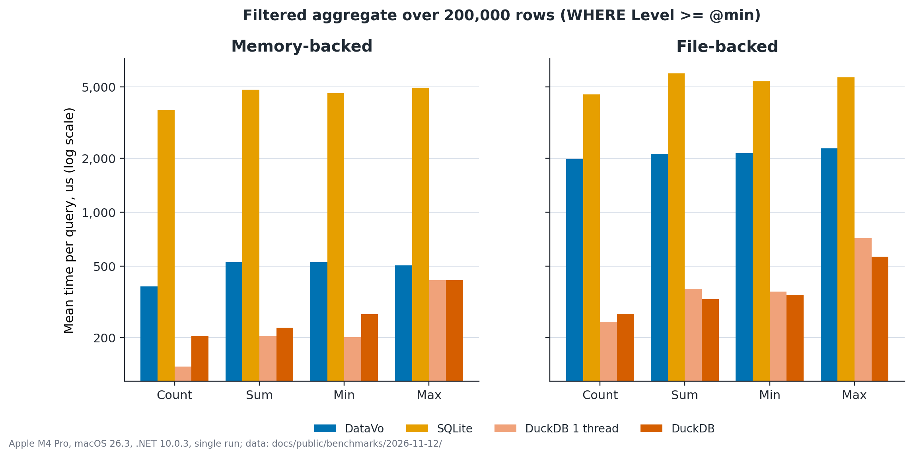
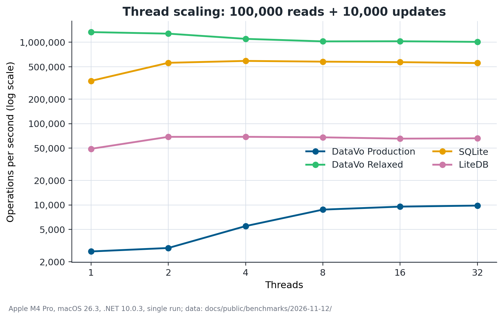
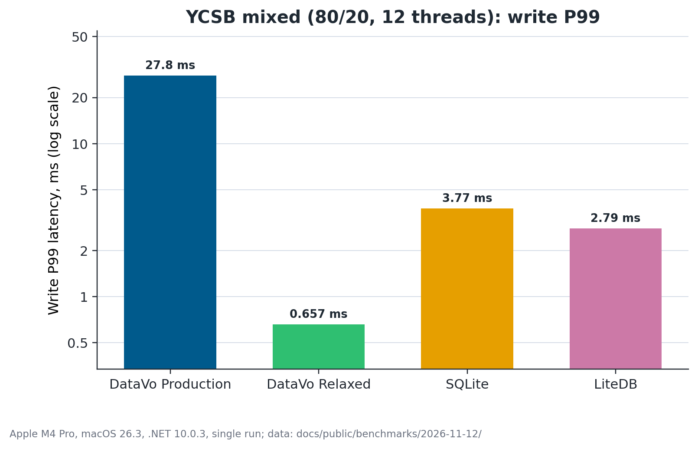
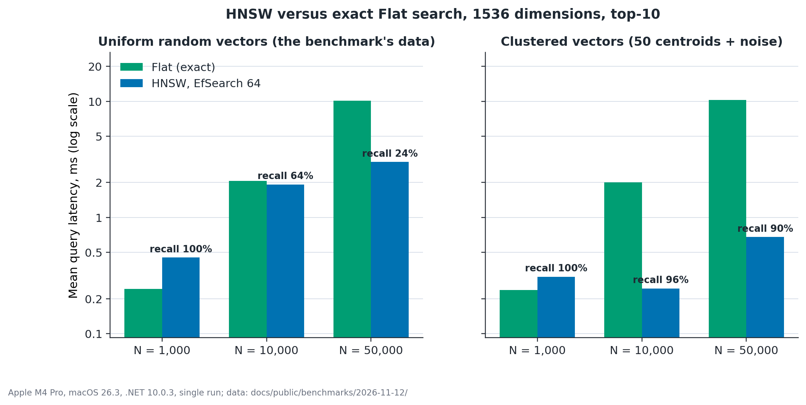
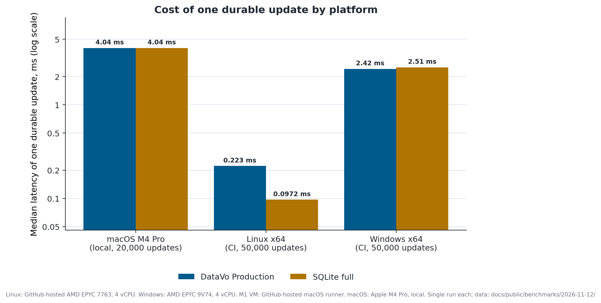
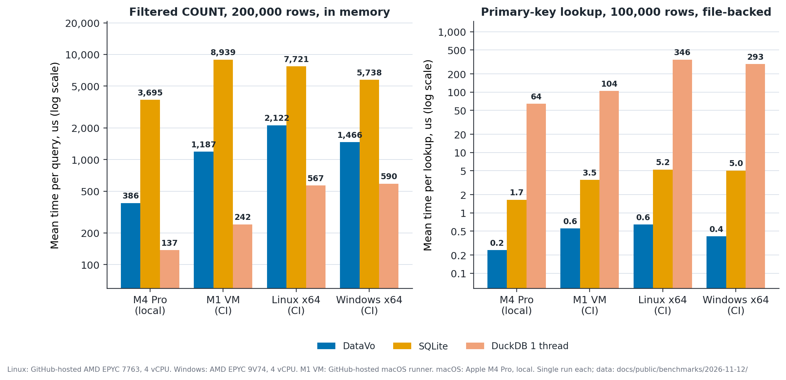
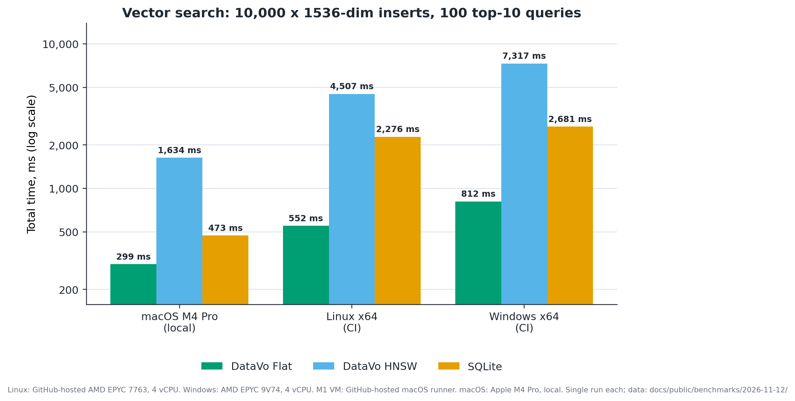

# DataVo

[](LICENSE)
[](https://arintonakos.github.io/DataVo-DBMS/)
[](https://www.nuget.org/packages/DataVo.Core/)
[](#install-with-npm)


DataVo is an embeddable SQL engine for .NET, designed for local-first applications, game tooling, and browser-native workflows.

Use DataVo when you want:

- predictable in-process SQL execution
- no mandatory external DB service for local scenarios
- one engine across desktop, backend, and browser/WebAssembly experiences

## Why customers use DataVo

- Embedded SQL runtime with in-memory and disk-backed storage
- Built in C# with deterministic behavior and testable execution paths
- Security and auth SQL commands for principal and grant management
- Browser and WebAssembly support for interactive and local-first applications
- Integration direction for ADO.NET and Entity Framework workflows

## Benchmarks

Measured on 12 November 2026 with `.NET 10.0.3` on an Apple M4 Pro (macOS 26.3, arm64), one run per scenario. These are local results, not universal database rankings: storage mode, durability setting, hardware, filesystem behavior and workload shape all matter. The [results page](https://arintonakos.github.io/DataVo-DBMS/manual/performance/benchmarks) gives every table, the commands, and the reasoning behind each result, including where DataVo loses.

The most important distinction is durability. `DataVo LSM Production` waits for the log to reach stable storage before acknowledging a write. `DataVo LSM Relaxed` acknowledges after the operating system accepts the write, so recent writes can be lost on power failure. Only compare rows with the same durability.

BenchmarkDotNet suite against `Microsoft.Data.Sqlite` and DuckDB (`benchmarks/DataVo.Benchmarks`):

- Filtered `COUNT`, `SUM`, `MIN` and `MAX` over 200,000 in-memory rows: DataVo takes 386 to 526 µs and allocates nothing. That is 9 to 10 times faster than SQLite. DuckDB held to one thread is 1.2 to 2.8 times faster than DataVo, and 3 to 8 times faster on file-backed data, because it is a column store.
- One row by primary key: 52.1 ns in memory and 236 ns on the LSM engine for DataVo, versus 736 ns and 1,609 ns for SQLite, and 65–75 µs for DuckDB.
- Loading 100,000 rows: DataVo and DuckDB are within noise of each other in memory. On files the DataVo and SQLite results overlap.

Systems workloads (`demos/Research.Benchmark`):

- A three-table join kept up to date incrementally: 192 ms for 50,000 insert-and-read iterations, against 34 s for DuckDB and 126 s for SQLite recomputing the query each time. On a single-table aggregate DataVo is only 1.1 times faster than SQLite.
- Durable updates: DataVo LSM Production and SQLite (WAL, `synchronous=FULL`, `fullfsync`) both take about 4.0 ms per update, because both wait for the drive.
- Without that wait, YCSB mixed on 12 threads: `510,695 ops/s` and `0.66 ms` write P99 for DataVo LSM Relaxed, `261,618 ops/s` and `3.77 ms` for SQLite WAL normal.
- 1,000,000 records: 27.7 MB on disk for DataVo, 29.1 MB for SQLite, 154.5 MB for LiteDB.
- Vector search, 10,000 vectors of 1,536 dimensions: exact Flat search takes 299 ms in total, `sqlite-vec` 473 ms, HNSW 1,634 ms. On uniform random vectors HNSW finds only 64% of the true neighbours at this size; on clustered vectors it is 8 times faster than Flat at 96% recall.
- SQL text over 1,000,000 rows: faster than SQLite on `GROUP BY` and joins, slower on `COUNT` with a filter, `ORDER BY ... LIMIT` and range scans, and 49 to 118 times slower than DuckDB on full scans.

macOS arm64 charts:









Durable point updates (`disk-crud-wal`, both engines committing the same way): with every update its
own power-safe commit, DataVo LSM and SQLite (WAL, `synchronous=FULL`, `fullfsync`) tie at about 4 ms per
update on macOS, because both wait for the same flush. Without the power-loss guarantee, and when all
updates commit as one batch, SQLite is currently 1.4-2.6x faster and allocates less. An earlier chart here
batched DataVo's updates but not SQLite's and has been withdrawn.

Storage footprint (November 6, 2026, macOS arm64, 1M rows of `(Id, Name VARCHAR(20), Amount INT)`, both
engines given identical data, sizes after a clean close). LSM tables whose primary key is one INT or GUID
column are clustered: rows are stored under their key, with no separate primary-key index.

| 1M rows | DataVo LSM (clustered) | DataVo LSM (engine row ids) | SQLite |
| --- | --- | --- | --- |
| INT key, size | 21.0 MB | 41.4 MB | 19.0 MB (`INTEGER PRIMARY KEY`) |
| GUID key (version 7), size | 29.3 MB | 61.4 MB | 35.4 MB (16-byte `BLOB`, `WITHOUT ROWID`) |
| INT key, typed bulk insert, open to close | 0.42-0.46 s | 1.6 s | 0.43-0.56 s (one transaction) |
| GUID key, typed bulk insert, open to close | 0.87-0.92 s | 2.2 s | 0.72 s |

Clustering halves the INT table and makes GUID tables smaller than SQLite's best layout for them. INT
inserts match SQLite; GUID inserts are about 20% slower. DataVo ran with relaxed durability (no fsync
before close) and SQLite with its default one fsync at commit, which favours DataVo slightly. Clustering
is on by default for new tables (`DataVoConfig.ClusteredPrimaryKeys`).

Cross-platform results from GitHub Actions on 12 November 2026 (virtual machines with four logical cores, one run each; see [Part III](docs/manual/performance/benchmarks.md#part-iii-platforms) for what they do and do not show):







More detail, including scenario commands and caveats: [docs/manual/performance/benchmarks.md](docs/manual/performance/benchmarks.md).

## Install with NuGet

DataVo preview packages are published on [nuget.org](https://www.nuget.org/packages/DataVo.Core/). Because these are prerelease versions, include `--prerelease`:

```bash
dotnet add package DataVo.Core --prerelease
dotnet add package DataVo.Data --prerelease
dotnet add package DataVo.EntityFrameworkCore --prerelease
# Optional, for source-generated compiled queries:
dotnet add package DataVo.Generators --prerelease
```

Releases publish automatically from CI via [NuGet Trusted Publishing](https://learn.microsoft.com/nuget/nuget-org/trusted-publishing) (OIDC — no stored API keys) whenever a `v*.*.*` tag is pushed.

## Vector search example

Get started with similarity search on embeddings:

```csharp
using DataVo.Data;

using var connection = new DataVoConnection("StorageMode=Disk;DataSource=Products");
connection.Open();

using var create = connection.CreateCommand();
create.CommandText = @"
  CREATE TABLE Items (
    Id INT PRIMARY KEY,
    Name VARCHAR(100),
    Vector VECTOR(3)
  )";
create.ExecuteNonQuery();

// Create vector index for fast approximate nearest-neighbor search
using var index = connection.CreateCommand();
index.CommandText = "CREATE INDEX IX_Items_Vector ON Items (Vector) USING HNSW";
index.ExecuteNonQuery();

// Insert embeddings. Vector values are currently passed as SQL vector literal strings.
string embedding = "[0.1,0.2,0.3]";
using var insert = connection.CreateCommand();
insert.CommandText = "INSERT INTO Items VALUES (@id, @name, @vec)";
insert.Parameters.AddWithValue("@id", 1);
insert.Parameters.AddWithValue("@name", "Widget");
insert.Parameters.AddWithValue("@vec", embedding);
insert.ExecuteNonQuery();

// Find similar items (automatic HNSW ANN search)
string queryVector = "[0.2,0.1,0.4]";
using var search = connection.CreateCommand();
search.CommandText = @"
  SELECT Id, Name, Vector <=> @query AS similarity
  FROM Items
  ORDER BY similarity ASC
  LIMIT 10
";
search.Parameters.AddWithValue("@query", queryVector);

using var similar = search.ExecuteReader();
while (similar.Read())
{
  Console.WriteLine($"{similar["Id"]}: {similar["Name"]} ({similar["similarity"]})");
}
```

### Entity Framework (example)

DataVo supports regular LINQ for non-vector queries and now supports vector distance translation in native preview via `DataVoVectorDbFunctions`:

```csharp
using DataVo.EntityFrameworkCore;
using Microsoft.EntityFrameworkCore;

public class AppDbContext : DataVoDbContext
{
  public DbSet<ItemEmbedding> Items { get; set; }

  protected override void OnConfiguring(DbContextOptionsBuilder optionsBuilder)
    => optionsBuilder.UseDataVo("./embeddings.db");
}

public class ItemEmbedding
{
  public int Id { get; set; }
  public string Name { get; set; }
  public float[] Vector { get; set; } // maps to VECTOR(3)
}

using var ef = new AppDbContext();
float[] q = new float[] { 1f, 0f, 0f };

// Normal LINQ (non-vector)
var activeNames = ef.Items
  .Where(x => x.Id > 0)
  .Select(x => x.Name)
  .ToList();

// LINQ vector distance (native translation preview)
var similar = ef.QueryFromDataVo<ItemEmbedding>(s => s
  .OrderBy(x => DataVoVectorDbFunctions.CosineDistance(EF.Functions, x.Vector, q))
  .Take(5));

foreach (var r in similar)
  Console.WriteLine($"{r.Id}: {r.Name}");
```

### Local feed (available now)

```bash
dotnet pack DataVo.sln -c Release
dotnet add package DataVo.Core --source ./artifacts/packages
dotnet add package DataVo.Data --source ./artifacts/packages
```

### SQL DATE preview migration

SQL `DATE` now materializes as `DataVo.Core.DataVoDate` in preview row APIs. `CellValue.AsDate()` and compiled `GetDate`/`GetDateOrNull` return `DataVoDate`. On modern .NET, use the explicit `DataVoDate.FromDateOnly(...)`, `dataVoDate.ToDateOnly()`, `CellValue.AsDateOnly()`, and compiled `GetDateOnly`/`GetDateOnlyOrNull` adapters when a `System.DateOnly` is required. Existing persisted `DATE` bytes are unchanged; this API migration does not require a storage rewrite.

## Install with npm

### Public package (planned)

For JavaScript and TypeScript consumers, the public npm package will follow this flow:

```bash
npm install @datavo/wasm
```

### Browser/WASM assets (available now)

```bash
bash ./scripts/deploy-browser-wasm.sh
cd docs
npm install
npm run docs:dev
```

This provides the current browser runtime and playground experience while npm distribution is being finalized.

## 60-second example

```csharp
using DataVo.Core;
using DataVo.Core.StorageEngine.Config;

using var db = new DataVoContext(new DataVoConfig
{
    StorageMode = StorageMode.InMemory
});

db.Execute("CREATE DATABASE Demo");
db.Execute("USE Demo");
db.Execute("CREATE TABLE Users (Id INT PRIMARY KEY, Name VARCHAR(50))");
db.Execute("INSERT INTO Users VALUES (1, 'Alice')");

var result = db.Execute("SELECT * FROM Users ORDER BY Id");
```

## End-user scenarios

### .NET application teams

- Embed SQL capabilities directly into services and desktop applications.

### AI and ML applications

- Semantic search on document embeddings (RAG, LLM applications)
- Vector-based recommendation engines
- Similarity matching without external vector databases
- Hybrid neural-lexical search combining text and vector similarity

### Unity and Godot evaluation

- Unity is an evaluation target, not a supported runtime.
- The public `DataVo.Core` package still contains only a `net10.0` asset.
- `DataVoEnablePortableTarget=true` creates an experimental local `netstandard2.1` candidate only; it does not publish or support a Unity package.
- On the portable candidate, Disk and LSM pass save, close and reopen in the Unity 6000.5.4f1 macOS Editor and a macOS IL2CPP Player; other platforms are unverified.
- Passing the portable-asset .NET-host verifier alone is not Unity Editor, Mono, IL2CPP, Jobs, or Burst proof.
- A narrow macOS IL2CPP smoke proof is recorded for Unity 6000.5.4f1 only. It covers the tracked candidate, `StorageMode.InMemory`, automatic Unity value binding, Medium stripping, Player launch, and a successful result report; it is not Windows, Burst, Jobs, or save-data support.
- Direct Burst calls are unsupported by design. The planned boundary is a blittable job batch drained by managed code after the job completes.

### Browser and WebAssembly products

- Run DataVo in a browser-backed runtime for demos, sandboxes, and local-first UX.
- Use the same core SQL workflows in docs, prototypes, and product surfaces.

### Entity Framework adopters

- Use the DataVo EF integration path for model-driven workflows.
- Follow the integration docs for current capability boundaries and roadmap status.

## Implemented SQL surface (high level)

- Querying and DML: `SELECT`, `INSERT`, `UPDATE`, `DELETE`
- DDL: `CREATE TABLE`, `CREATE INDEX`, `ALTER TABLE` (supported operations)
- Transactions: `BEGIN`, `COMMIT`, `ROLLBACK`
- Security/auth:
  - `CREATE USER`, `CREATE ROLE`
  - `GRANT`, `REVOKE`
  - `LOGIN`, `LOGOUT`
  - `SHOW USERS`, `SHOW ROLES`, `SHOW GRANTS`
- Vector search and indexing:
  - `VECTOR(n)` column type with fixed dimensionality
  - `CREATE INDEX ... USING HNSW` for approximate nearest-neighbor
  - Distance operators: `<->` for L2 and `<=>` for cosine
  - Hybrid queries (vector + lexical filters + joins)
  - Exact brute-force and fast ANN modes

## Documentation

- Product docs: [docs/index.md](docs/index.md)
- Setup and packaging: [docs/features/setup-and-packaging.md](docs/features/setup-and-packaging.md)
- WebAssembly and npm integration: [docs/features/wasm-and-npm.md](docs/features/wasm-and-npm.md)
- Unity and Godot evaluation status: [docs/features/unity-and-godot.md](docs/features/unity-and-godot.md)
- Entity Framework integration: [docs/features/entity-framework.md](docs/features/entity-framework.md)
- Vector search guide: [docs/features/vector-queries-guide.md](docs/features/vector-queries-guide.md) — Complete guide to vector columns, distance metrics, exact vs. ANN search
- Query features: [docs/features/select-and-querying.md](docs/features/select-and-querying.md)
- Schema and DDL: [docs/features/schema-and-ddl.md](docs/features/schema-and-ddl.md)

## Status

DataVo is preview software aimed at local-first and embeddable database scenarios.

- Preview packages are published on nuget.org (prerelease); local package distribution is also available.
- Browser/WebAssembly runtime support is available now.
- Public npm publication is still in preparation.
- Unity and Godot runtime compatibility remains unverified; do not treat the current packages as game-runtime support.
- Production-hardening work is active; validate representative workloads before production adoption.

## License

MIT. See [LICENSE](LICENSE).
