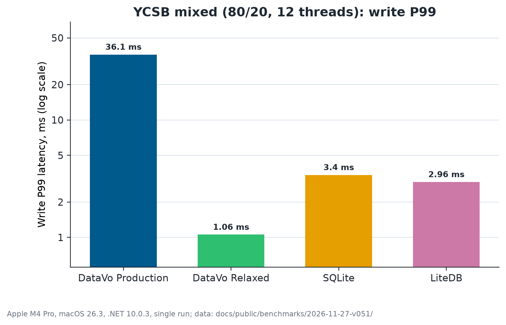

# DataVo

[](LICENSE)
[](https://arintonakos.github.io/DataVo-DBMS/)
[](https://www.nuget.org/packages/DataVo.Core/)


**Pure C# embedded database for .NET 10** — in-process SQL, crash-safe LSM storage, columnar indexes, HNSW vector search, live Z-set reactive views, and build-time compiled LINQ. No external server, no native binaries, and Native AOT clean (`IL2026`/`IL3050` enforced as errors).

## Try it in 30 seconds

```bash
dotnet add package DataVo.Core --prerelease
```

```csharp
using DataVo.Core;
using DataVo.Core.StorageEngine.Config;

using var db = new DataVoContext(new DataVoConfig { StorageMode = StorageMode.InMemory });
db.Execute("CREATE DATABASE Demo");
db.Execute("USE Demo");
db.Execute("CREATE TABLE Users (Id INT PRIMARY KEY, Name VARCHAR(50))");
db.Execute("INSERT INTO Users VALUES (1, 'Alice')");

var result = db.Execute("SELECT * FROM Users ORDER BY Id");
```

Switch to power-loss-durable persistence on disk with two config lines:

```csharp
using var db = new DataVoContext(new DataVoConfig
{
    StorageMode = StorageMode.Lsm,
    DiskStoragePath = "./app_data",
    LsmStrictFsync = true
});
```

## Why DataVo? (vs. SQLite)

- **100% managed C# — zero native binaries:** No `e_sqlite3` `.dll`/`.so`/`.dylib` bundling, no P/Invoke boundary overhead, and no per-string UTF-8/UTF-16 marshaling on hot paths.
- **Native AOT & zero-reflection compiled LINQ:** `DataVo.Generators` compiles `DataVoTable<T>` lambdas and `[DataVoQuery]` methods at build time with Roslyn interceptors—no EF Core dependency, zero trim/AOT warnings.
- **Built-in SQL + vector search:** Native `VECTOR(n)` columns with SIMD-accelerated `FLAT` (exact) and `HNSW` indexes (`<=>` cosine, `<->` Euclidean) in the same WAL and transaction boundary—no separate `sqlite-vec` native extension.
- **Out-of-core columnar indexes:** `CREATE INDEX ... USING COLUMNAR` writes 4,096-row zone-mapped segments into LSM SSTables for zero-allocation aggregates (`COUNT`/`SUM`/`MIN`/`MAX`) without rebuilding on reopen.
- **Live Z-set reactive views:** Incremental view maintenance (DBSP-style) updates multi-table join dashboards in O(1) per write instead of re-running queries.

**What DataVo is not:** It is not a client/server database. One process owns a database directory (`datavo.lock`), there is no wire protocol or built-in replication, transactions use MVCC snapshot isolation (not serializable predicate locking), and the SQL dialect is DataVo's own.

## Performance at a Glance

All figures below are verified against an independent oracle (0 mismatches) on an Apple M4 Pro (macOS 26.3, .NET 10.0.3, arm64) with warm page cache. Compare only configurations with matching durability (`LSM Production` ↔ SQLite `synchronous=FULL`; `LSM Relaxed` ↔ SQLite WAL `NORMAL`).

| Workload | DataVo | Comparison | Notes |
| :--- | :--- | :--- | :--- |
| **PK point lookup (100k rows)** | **55 ns** (InMemory, 56 B) · **216 ns** (LSM, 144 B) | SQLite: 716 ns / 1,654 ns (608 B) | Compiled LINQ; 8–12× faster on Linux/Windows x64 CI too |
| **Filtered aggregates (200k rows, `[Columnar]`)** | **27–90 µs** (0 B alloc, InMemory & LSM) | SQLite: 3.7–5.6 ms · DuckDB 1t: 123–701 µs | 55–162× faster than SQLite; 2.6–8.4× faster than 1-thread DuckDB |
| **1M-row SQL (`GROUP BY`, 2–3 table `JOIN`)** | **2.3–9.7× faster** than SQLite (LSM Relaxed) | `GROUP BY` 4–1k groups: 2.8–3.0× · Columnar agg: 5–14× | 28-query v0.4 matrix vs. SQLite WAL `NORMAL` |
| **Filtered top-10 vector search (50k × 384d)** | **0.67–3.6 ms** (HNSW) · **2.0–4.3 ms** (Flat) | SQLite + `sqlite-vec`: 9.8–14.4 ms (exact) | 100% Recall@10 across all three, no short results |
| **Reactive IVM (3-table join, 50k updates)** | **192 ms** (3.1 µs P50) | DuckDB: 34.3 s · SQLite: 126.1 s | Incremental Z-sets vs. recomputing (single-table agg is ~1.1×) |
| **YCSB 80/20 mixed (12 threads, Relaxed)** | **510,695 ops/s** (0.66 ms write P99) | SQLite WAL `NORMAL`: 261,618 ops/s (3.77 ms P99) | Non-power-loss-durable mode on both engines |
| **Durable single update (`fsync` per commit)** | **~4.0 ms** (LSM Production) | SQLite WAL `FULL` + `fullfsync`: **~4.0 ms** | Drive flush dominates on macOS/Windows; SQLite leads on fast-flush Linux VM |

**Where DataVo loses:**
- **High-cardinality indexed `GROUP BY` (125k groups):** 2.4× slower than SQLite (SQLite streams in index order).
- **Unindexed full scans (`OR`, `LIKE`, unindexed aggregates, unindexed `ORDER BY ... LIMIT 10`):** 1.1–2.1× slower than SQLite; `LEFT JOIN` anti-join is 1.2× slower.
- **Whole-table analytical scans:** DuckDB (parallel column store) is faster than both DataVo and SQLite on full-table scans, and slower on key lookups and ranges.
- **Cross-platform scaling:** On x64 GitHub Actions VMs, DataVo's lead over SQLite on row scans is 2–2.8× smaller than on Apple Silicon (point lookups remain **8.4–12.6× faster** and `[Columnar]` `COUNT(*)` remains **491–844× faster**).




Full tables, methodology, cross-platform CI runs, and raw outputs:
- [DataVo vs SQLite (28 SQL shapes + hybrid vector, v0.4)](https://arintonakos.github.io/DataVo-DBMS/manual/performance/datavo-vs-sqlite) · raw logs in [`docs/public/benchmarks/2026-11-16-v04-final/`](docs/public/benchmarks/2026-11-16-v04-final/)
- [Benchmark Results & Cross-Platform CI](https://arintonakos.github.io/DataVo-DBMS/manual/performance/benchmarks) ([Part III: Platforms](docs/manual/performance/benchmarks.md#part-iii-platforms))
- Engineering deep-dives: [Part 1: Where It Wins and Where It Loses](https://arintonakos.github.io/DataVo-DBMS/blog/part-1-where-it-wins-and-where-it-loses) · [Part 2: Packed Buffers, Native AOT & Roslyn Codegen](https://arintonakos.github.io/DataVo-DBMS/blog/part-2-packed-buffers-aot-and-roslyn-codegen)

## Install

Latest prereleases on [nuget.org](https://www.nuget.org/packages/DataVo.Core/) (**0.4.0-rc.1**, 17 November 2026 — shipping both the **v0.3** and **v0.4** milestones; see the [roadmap](https://arintonakos.github.io/DataVo-DBMS/manual/getting-started/roadmap)):

```bash
dotnet add package DataVo.Core --prerelease
dotnet add package DataVo.Data --prerelease                  # ADO.NET provider, also used by Dapper
dotnet add package DataVo.Generators --prerelease            # compiled LINQ, no EF Core dependency
dotnet add package DataVo.EntityFrameworkCore --prerelease   # EF Core bridge (not a full provider)
```

To build packages locally from this repository:

```bash
dotnet pack DataVo.sln -c Release
dotnet add package DataVo.Core --source ./artifacts/packages
```

Releases are published from CI with [NuGet Trusted Publishing](https://learn.microsoft.com/nuget/nuget-org/trusted-publishing) when a `v*.*.*` tag is pushed.

## More Examples

### Compiled LINQ over a typed table (`DataVo.Generators`)

```csharp
[DataVoTable("players")]
public sealed class Player
{
    [PrimaryKey] public int Id { get; set; }
    [Indexed, Columnar] public int Level { get; set; }
    public string Name { get; set; } = "";
}

var players = db.Table<Player>();

// Intercepted at build time — zero reflection, Native AOT safe.
Player? p = players.FirstOrDefault(42, static (p, key) => p.Id == key);
int veterans = players.Where(50, static (p, min) => p.Level >= min).Count();
```

### Filtered vector search through ADO.NET (`DataVo.Data`)

```csharp
using DataVo.Data;

using var connection = new DataVoConnection("StorageMode=Lsm;DataSource=Products");
connection.Open();

using var create = connection.CreateCommand();
create.CommandText = "CREATE TABLE Items (Id INT PRIMARY KEY, Name VARCHAR(100), Category INT, Embedding VECTOR(3))";
create.ExecuteNonQuery();

using var index = connection.CreateCommand();
index.CommandText = "CREATE INDEX IX_Items_Vector ON Items (Embedding) USING HNSW WITH (metric = 'cosine')";
index.ExecuteNonQuery();

using var insert = connection.CreateCommand();
insert.CommandText = "INSERT INTO Items VALUES (@id, @name, @category, @vec)";
insert.Parameters.AddWithValue("@id", 1);
insert.Parameters.AddWithValue("@name", "Widget");
insert.Parameters.AddWithValue("@category", 7);
insert.Parameters.AddWithValue("@vec", "[0.1,0.2,0.3]");
insert.ExecuteNonQuery();

using var search = connection.CreateCommand();
search.CommandText = @"
  SELECT Id, Name, Embedding <=> @query AS distance
  FROM Items
  WHERE Category = @category
  ORDER BY distance ASC
  LIMIT 10";
search.Parameters.AddWithValue("@query", "[0.2,0.1,0.4]");
search.Parameters.AddWithValue("@category", 7);

using var reader = search.ExecuteReader();
while (reader.Read())
{
    Console.WriteLine($"{reader["Id"]}: {reader["Name"]} ({reader["distance"]})");
}
```

## How It Works

- **Two active storage engines:** `InMemory` packs rows into contiguous fixed-width cells (`FlatRowStore`). `Lsm` appends commits to a WAL (flushed to stable storage when `LsmStrictFsync = true`), applies them to an arena-backed MemTable, flushes immutable memory-mapped SSTables at 32 MB in the background, and compacts them asynchronously. Single-column `INT`/`GUID` primary keys are clustered; secondary indexes are keyed SSTables committed atomically with their rows; HNSW graphs snapshot on close and catch up from the WAL on open. (`Disk`, an earlier paged engine, is legacy.)
- **Columnar indexes:** `CREATE INDEX ... USING COLUMNAR` keeps chosen columns as contiguous buffers, persisted into LSM SSTables as 4,096-row segments with per-chunk min/max zone maps so aggregates skip excluded chunks out of core without rebuilding on open.
- **Typed execution fast paths:** SQL is first offered to typed paths reading directly from stored bytes (single-table scans with `AND`/`OR`/`LIKE`, UTF-8 byte comparisons, unboxed grouping, in-place top-k, key ranges, integer-key hash joins, index-driven joins, dense bit-set anti-joins, columnar aggregates, and cost-based vector search). Any unsupported shape cleanly falls back to the general evaluator.
- **Hybrid vector search:** Filtered `VECTOR(n)` queries test predicates on stored candidate rows, automatically switch from HNSW to an exact SIMD scan when selectivity makes graph traversal more expensive, and fall back to a filter-first exact scan rather than returning too few rows.

## Platforms

- **.NET 10** is the supported runtime. The published `DataVo.Core` package currently ships a `net10.0` asset; multi-target packages (`net8.0`, `net9.0`, `net10.0`, `netstandard2.1`) are planned for v0.5.
- **Native AOT:** `DataVo.Core`, `DataVo.Data`, and `DataVo.Generators` output publish cleanly with `PublishAot=true`. The EF Core preview bridge is excluded from AOT.
- **Unity** is an evaluation target, not a supported runtime. `DataVoEnablePortableTarget=true` builds an experimental local `netstandard2.1` candidate; a narrow smoke (in-memory, LSM and Disk save/reopen) passes in the Unity 6000.5.4f1 macOS Editor and a macOS IL2CPP Player. Windows IL2CPP is unverified and direct Burst calls are unsupported by design.
- **Browser / WebAssembly:** `DataVo.Browser` powers the documentation site's playground. It is experimental and not published on npm. To run it locally: `bash ./scripts/deploy-browser-wasm.sh`, then `cd docs && npm install && npm run docs:dev`.

## Commercial Add-On: DataVo Sync

For teams that need **offline-first, bidirectional synchronization between PostgreSQL (including Supabase) and embedded DataVo clients**, **DataVo Sync** is available as a separate commercial add-on (not included in this MIT repository).

It pairs PostgreSQL logical replication (`pgoutput`), Z-set delta compaction, per-column conflict resolution, crash-recoverable outbox write-back, and WebSocket/HTTP transport with DataVo's local `InMemory` and `Lsm` stores. On Ubuntu x64 (2 vCPU, PostgreSQL 17.12), a warm 100k-row initial sync completes in **605 ms** (`InMemory`) / **706–726 ms** (`LSM`) at **45.5 B/row** on the wire (Brotli v2), sustaining **140k rows/s** fan-out across 50 clients.

SQL Server Change Tracking / CDC is available on request for Early Access partners. See [DataVo-Sync docs](docs/manual/fundamentals/datavo-sync.md), [request Early Access](https://tally.so/r/RWD8G9), or email `datavodb@proton.me`.

## Documentation

The full manual is live at [arintonakos.github.io/DataVo-DBMS](https://arintonakos.github.io/DataVo-DBMS/) and in [`docs/manual/`](docs/manual/):

- [Introduction](docs/manual/getting-started/introduction.md) · [Quickstart](docs/manual/getting-started/quickstart.md) · [Choosing an Interface](docs/manual/getting-started/choosing-an-interface.md) · [Status & Roadmap](docs/manual/getting-started/roadmap.md)
- [Storage Modes](docs/manual/fundamentals/storage-modes.md) · [LSM & Durability](docs/manual/fundamentals/lsm-and-durability.md) · [Transactions & MVCC](docs/manual/fundamentals/transactions-and-mvcc.md) · [Vector Search](docs/manual/fundamentals/vector-search.md) · [Live Reactive Views](docs/manual/fundamentals/reactive-views.md)
- [SQL Compatibility](docs/manual/sql/compatibility.md) · [Query Planner & Fast Paths](docs/manual/internals/query-planner.md) · [Zero-Allocation Rows](docs/manual/internals/zero-allocation-rows.md)
- [Roslyn Source Generators](docs/manual/client-interfaces/source-generators.md) · [Compiled LINQ](docs/manual/client-interfaces/compiled-linq.md) · [ADO.NET](docs/manual/client-interfaces/ado-net.md) · [Dapper](docs/manual/client-interfaces/dapper.md) · [Entity Framework Core](docs/manual/client-interfaces/entity-framework.md)
- [DataVo vs SQLite](docs/manual/performance/datavo-vs-sqlite.md) · [Benchmark Results](docs/manual/performance/benchmarks.md) · [Reproducing Benchmarks](docs/manual/performance/reproducing-benchmarks.md)
- [Limits & Unsupported Features](docs/manual/reference/limits.md) · [Configuration](docs/manual/reference/configuration.md) · [AI Access & MCP](docs/manual/reference/ai-access.md)

## Status

DataVo is prerelease software (`0.4.0-rc.1`). The documented SQL dialect and C# APIs are the release-candidate surface being verified; the on-disk format does not yet carry a long-term cross-version compatibility guarantee, so keep an export or seed script for important data. Validate your own workload before relying on it in production.

## License

MIT. See [LICENSE](LICENSE).
