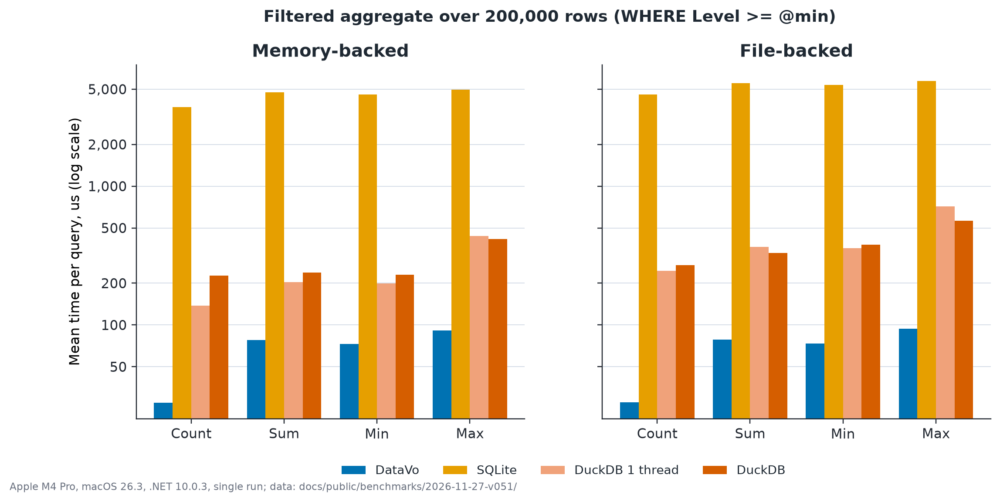

# DataVo

[](LICENSE)
[](https://arintonakos.github.io/DataVo-DBMS/)
[](https://www.nuget.org/packages/DataVo.Core/)


DataVo is an embedded database engine written in C# for .NET 10. It runs inside your process, with no server and no native library: storage, SQL execution and vector indexes are managed code, and `DataVo.Core` builds with the trim and Native AOT analyzers as errors.

**Versions.** The latest packages on nuget.org are **0.2.0-rc.3** (10 November 2026). This repository's `master` branch has since completed the **v0.3** (columnar indexes, compact in-memory rows) and **v0.4** (columnar SSTables, SQL and vector correctness, typed execution) milestones, which are not yet published. The [roadmap](https://arintonakos.github.io/DataVo-DBMS/manual/preface/roadmap) lists what each added and what v0.5 plans.

## How it works

- **Two storage engines.** `InMemory` packs rows into contiguous fixed-width cells. `Lsm` is a log-structured merge tree: each commit is appended to a log and, with `LsmStrictFsync = true` (the default), flushed to stable storage before it is acknowledged; it is then applied to an arena-backed MemTable, which is flushed at 32 MB to an immutable SSTable in the background and later compacted. Tables keyed by one `INT` or `GUID` column are clustered by that key, SSTables are memory-mapped, secondary indexes are keyed SSTables committed with their rows, and HNSW graphs are snapshotted on close and caught up from the log on open. (`Disk`, an earlier paged engine, is legacy.)
- **Columnar indexes.** `CREATE INDEX ... USING COLUMNAR` keeps chosen columns as contiguous buffers. On LSM they are written into the SSTables as 4,096-row segments with per-chunk min/max zone maps, so aggregates are read out of core, skip chunks the predicate excludes, and need no rebuild on open.
- **Typed execution.** SQL is first offered to typed paths that read cells directly from stored rows: a single-table scan (`AND`/`OR`/`LIKE`, grouping, bounded top-k, key ranges, index lookups, text compared as stored UTF-8), a hash join for `INNER`/`LEFT` joins on integer keys, columnar aggregates, and a vector-search planner. A typed path returns exactly what the general evaluator would, or declines; the general evaluator handles everything else, at a cost of kilobytes of allocation per row.
- **Vector search in SQL.** `VECTOR(n)` columns with `FLAT` (exact, SIMD) and `HNSW` indexes, cosine `<=>` and Euclidean `<->`. A filtered search tests the filter on stored candidate rows, switches HNSW to an exact scan when the candidate count makes the graph walk more expensive, and falls back to an exact filter-first scan rather than return too few rows.
- **Compiled LINQ without EF Core.** `DataVo.Generators` turns `DataVoTable<T>` lambdas and `[DataVoQuery]` methods into code at build time with Roslyn interceptors. It has no Entity Framework dependency and is Native AOT clean.

It is not a client/server database: one process owns a database directory (`datavo.lock`), there is no wire protocol or replication, transactions are snapshot-isolated rather than serializable, and the SQL is DataVo's own dialect.

## Performance

All figures are from one Apple M4 Pro (macOS 26.3, .NET 10.0.3, arm64), one run per scenario, data in the page cache. They describe this machine, not a universal ranking. Compare only rows with the same durability: `DataVo LSM Production` and SQLite `synchronous=FULL` wait for the drive on every commit; `DataVo LSM Relaxed` and SQLite `synchronous=NORMAL` do not, and can lose recent commits on power failure.

**SQL and vector queries, v0.4 engine, 17 November 2026** ([DataVo vs SQLite](https://arintonakos.github.io/DataVo-DBMS/manual/performance/datavo-vs-sqlite), raw output in [`docs/public/benchmarks/2026-11-16-v04-final/`](docs/public/benchmarks/2026-11-16-v04-final/)). 28 SQL shapes over 1,000,000 orders, DataVo LSM Relaxed against SQLite WAL `NORMAL`, prepared statements, every answer checked against an oracle (0 mismatches):

- Faster than SQLite: primary-key ranges (12 µs against 18 µs for 100 rows), an indexed equality lookup (2.4×), `GROUP BY` with 4 to 1,000 groups (2.8–3.0×), inner and `LEFT` joins of two or three tables on integer keys (2.3–9.7×), and aggregates answered by a columnar index (5–14×).
- Slower than SQLite: `GROUP BY` over 125,000 groups of an indexed key, which SQLite reads in index order (2.4×); unindexed `ORDER BY ... LIMIT 10` (1.4×); unindexed aggregates and full scans with `OR`, `LIKE` or an unindexed equality (1.1–2.1×); and a `LEFT JOIN` anti-join (1.2×).
- DuckDB, a parallel column store, is faster than both on every query that reads the whole table, and slower on key lookups and ranges.
- Filtered top-10 vector search over 50,000 × 384 clustered embeddings: DataVo Flat (exact) 2.0–4.3 ms and HNSW 0.67–3.6 ms, against 9.8–14.4 ms for SQLite with sqlite-vec (exact); recall@10 100% for all three, no short results.

**Storage and systems workloads, 0.2.0-rc.3 engine, 12 November 2026** ([results page](https://arintonakos.github.io/DataVo-DBMS/manual/performance/benchmarks)):

- One row by primary key: 52.1 ns in memory and 236 ns on LSM for DataVo, 736 ns and 1,609 ns for SQLite.
- Filtered `COUNT`/`SUM`/`MIN`/`MAX` over 200,000 in-memory rows through compiled LINQ: 386–526 µs with no allocation, 9 to 10 times faster than SQLite. DuckDB held to one thread is 1.2–2.8 times faster than DataVo without a columnar index, and 2.6–5.1 times slower with one.
- Durable updates: DataVo LSM Production and SQLite (WAL, `synchronous=FULL`, `fullfsync`) both take about 4.0 ms per update, the time the drive needs to flush.
- Without that flush, YCSB mixed on 12 threads: 510,695 ops/s and 0.66 ms write p99 for DataVo LSM Relaxed, 261,618 ops/s and 3.77 ms for SQLite WAL `NORMAL`.
- A three-table join kept current incrementally: 192 ms for 50,000 insert-and-read iterations, against 34 s for DuckDB and 126 s for SQLite recomputing it each time. On a single-table aggregate the incremental advantage is only 1.1×.
- 1,000,000 records: 27.7 MB on disk for DataVo, 29.1 MB for SQLite.




Cross-platform runs on GitHub Actions (four-core virtual machines) are in [Part III of the results page](docs/manual/performance/benchmarks.md#part-iii-platforms). DataVo's lead over SQLite on scans is 2 to 2.8 times smaller on x64 than on the M4 Pro.

## Install

Published prereleases on [nuget.org](https://www.nuget.org/packages/DataVo.Core/) (0.2.0-rc.3):

```bash
dotnet add package DataVo.Core --prerelease
dotnet add package DataVo.Data --prerelease                  # ADO.NET provider, also used by Dapper
dotnet add package DataVo.Generators --prerelease            # compiled LINQ, no EF Core dependency
dotnet add package DataVo.EntityFrameworkCore --prerelease   # EF Core bridge (not a full provider)
```

To use the v0.3/v0.4 features before they are published, build the packages from this repository:

```bash
dotnet pack DataVo.sln -c Release
dotnet add package DataVo.Core --source ./artifacts/packages
```

Releases are published from CI with [NuGet Trusted Publishing](https://learn.microsoft.com/nuget/nuget-org/trusted-publishing) when a `v*.*.*` tag is pushed.

## Examples

In memory:

```csharp
using DataVo.Core;
using DataVo.Core.StorageEngine.Config;

using var db = new DataVoContext(new DataVoConfig { StorageMode = StorageMode.InMemory });

db.Execute("CREATE DATABASE Demo");
db.Execute("USE Demo");
db.Execute("CREATE TABLE Users (Id INT PRIMARY KEY, Name VARCHAR(50))");
db.Execute("INSERT INTO Users VALUES (1, 'Alice')");

var result = db.Execute("SELECT * FROM Users ORDER BY Id");
```

Persisted, with power-loss-durable commits:

```csharp
using var db = new DataVoContext(new DataVoConfig
{
    StorageMode = StorageMode.Lsm,
    DiskStoragePath = "./app_data",
    LsmStrictFsync = true
});
```

Vector search through ADO.NET:

```csharp
using DataVo.Data;

using var connection = new DataVoConnection("StorageMode=Lsm;DataSource=Products");
connection.Open();

using var create = connection.CreateCommand();
create.CommandText = "CREATE TABLE Items (Id INT PRIMARY KEY, Name VARCHAR(100), Category INT, Embedding VECTOR(3))";
create.ExecuteNonQuery();

using var index = connection.CreateCommand();
index.CommandText = "CREATE INDEX IX_Items_Vector ON Items (Embedding) USING HNSW WITH (metric = 'cosine')";
index.ExecuteNonQuery();

using var insert = connection.CreateCommand();
insert.CommandText = "INSERT INTO Items VALUES (@id, @name, @category, @vec)";
insert.Parameters.AddWithValue("@id", 1);
insert.Parameters.AddWithValue("@name", "Widget");
insert.Parameters.AddWithValue("@category", 7);
insert.Parameters.AddWithValue("@vec", "[0.1,0.2,0.3]");
insert.ExecuteNonQuery();

using var search = connection.CreateCommand();
search.CommandText = @"
  SELECT Id, Name, Embedding <=> @query AS distance
  FROM Items
  WHERE Category = @category
  ORDER BY distance ASC
  LIMIT 10";
search.Parameters.AddWithValue("@query", "[0.2,0.1,0.4]");
search.Parameters.AddWithValue("@category", 7);

using var reader = search.ExecuteReader();
while (reader.Read())
{
    Console.WriteLine($"{reader["Id"]}: {reader["Name"]} ({reader["distance"]})");
}
```

Compiled LINQ over a typed table (requires `DataVo.Generators`):

```csharp
[DataVoTable("players")]
public sealed class Player
{
    [PrimaryKey] public int Id { get; set; }
    [Indexed] public int Level { get; set; }
    public string Name { get; set; } = "";
}

int veterans = db.Table<Player>().Where(50, static (p, min) => p.Level >= min).Count();
```

## Platforms

- **.NET 10** is the supported runtime. The published `DataVo.Core` package has only a `net10.0` asset; multi-target packages are planned for v0.5.
- **Native AOT:** `DataVo.Core`, `DataVo.Data` and generated code publish with `PublishAot=true`. The EF Core bridge is not covered.
- **Unity** is an evaluation target, not a supported runtime. `DataVoEnablePortableTarget=true` builds an experimental local `netstandard2.1` candidate; a narrow smoke (in-memory, LSM and Disk save/reopen) passes in the Unity 6000.5.4f1 macOS Editor and a macOS IL2CPP Player. Windows IL2CPP is unverified and direct Burst calls are unsupported by design.
- **Browser / WebAssembly:** `DataVo.Browser` runs the engine for the documentation site's playground. It is not production-ready and not published on npm. To run the playground locally: `bash ./scripts/deploy-browser-wasm.sh`, then `cd docs && npm install && npm run docs:dev`.

## Documentation

The manual is at [arintonakos.github.io/DataVo-DBMS](https://arintonakos.github.io/DataVo-DBMS/) and in [`docs/manual/`](docs/manual/). Good starting points:

- [What Is DataVo?](docs/manual/preface/what-is-datavo.md) and the [Roadmap](docs/manual/preface/roadmap.md)
- [Quickstart](docs/manual/tutorial/quickstart.md) and [Choosing an Interface](docs/manual/getting-started/choosing-an-interface.md)
- [SQL Compatibility Matrix](docs/manual/sql-language/sql-compatibility.md) and [Vector Search and Indexes](docs/manual/sql-language/vector-search-syntax.md)
- [LSM Mode](docs/manual/storage-engine/lsm-mode.md), [WAL And Durability](docs/manual/storage-engine/wal-and-durability.md) and [Query Planner And Fast Paths](docs/manual/storage-engine/query-planner-fast-paths.md)
- [Roslyn Source Generators](docs/manual/client-interfaces/source-generators.md) and [Entity Framework Core](docs/manual/client-interfaces/entity-framework.md)
- [DataVo vs SQLite](docs/manual/performance/datavo-vs-sqlite.md), [Benchmark Results](docs/manual/performance/benchmarks.md) and [Reproducing Benchmarks](docs/manual/performance/reproducing-benchmarks.md)
- [Limits](docs/manual/reference/limits.md) and [Unsupported Features](docs/manual/reference/unsupported-features.md)

## Status

DataVo is prerelease software. The documented SQL dialect and APIs are the surface being verified; the on-disk format has no long-term compatibility guarantee yet, so keep a way to rebuild important data. No production support contract is offered. Validate your own workload before relying on it.

## License

MIT. See [LICENSE](LICENSE).
