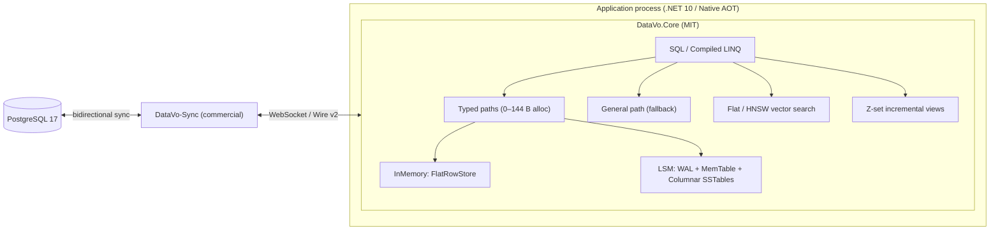
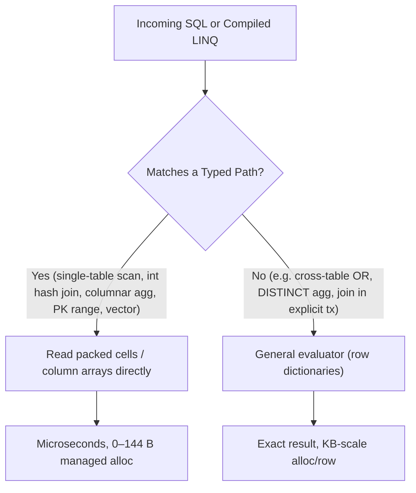
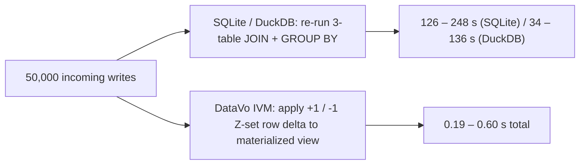

# I wrote an embedded database and Postgres sync engine in C#. Here is where it wins and where it loses.

*Part 1 of 6.*

If you are building a local-first .NET desktop app, an offline AI copilot, or a real-time simulation in C#, you usually end up gluing together three separate pieces: SQLite for tables, a vector store for embeddings, and custom JSON-over-WebSocket code to keep a local cache in sync with PostgreSQL.

I wanted to see what happens when all of that lives inside one managed .NET 10 process.

Over the last several months I have built two things: **DataVo-DBMS** (an MIT-licensed embedded relational, columnar, and vector database in pure C#, Native AOT clean) and **DataVo-Sync** (a separate, proprietary commercial add-on for bidirectional offline-first PostgreSQL sync).

Some of the results surprised me:
- **55 ns** in-memory point lookups (and **216 ns** on LSM disk files) via build-time Roslyn source generation — **7.7–13× faster** than SQLite on an M4 Pro, with 56–144 B allocated.
- **192 ms** vs **126 seconds** (**658× faster** than SQLite, **179× faster** than DuckDB) when updating a live 3-table `JOIN + GROUP BY` view across 50,000 writes, using Z-set incremental view maintenance.
- **0.26–3.6 ms** filtered top-10 vector search over 50,000 × 384-dim embeddings at **100% recall@10**, inside normal SQL `JOIN` + `WHERE` queries.
- **45.5 bytes per row** over the wire (**8× smaller** than ElectricSQL `1.8.1`, **5–7× lower** client GC allocations) in end-to-end PostgreSQL 17 sync, with automatic convergence after 500 offline writes.

And because synthetic wins mean nothing without context, this post also shows **everywhere SQLite, DuckDB, and ElectricSQL are still faster or simpler** — full-table unindexed scans, whole-table analytics, hub cold-start time, and what `fsync` actually costs on Windows vs Linux.

---

## 1. Four things you can actually build with this

Instead of treating an embedded database as an abstract benchmark target, here is where each part of DataVo fits real applications:

1. **Local-first desktop & mobile apps (MAUI, Avalonia, WPF) with Postgres sync:** Keep a real relational store locally so the UI never blocks on network round trips, let users keep inserting/updating while offline, and sync compressed deltas back to PostgreSQL (`DataVo-Sync`).
2. **Offline AI & RAG agents in C#:** Store document metadata, user permissions, and `VECTOR(n)` embeddings in **one** transaction log. Run `SELECT ... JOIN ... WHERE ... ORDER BY Embedding <=> @q LIMIT 10` without deploying Qdrant or pgvector locally.
3. **Live dashboards, leaderboards, and game HUDs (Unity / simulations):** Keep heavy multi-table `JOIN + GROUP BY` queries continuously up to date via incremental Z-set deltas (`192–600 ms` across 50,000 updates instead of re-querying for minutes).
4. **Zero-interop Native AOT microservices & tools:** `DataVo.Core` and `DataVo.Data` compile with trimming and Native AOT analyzers set to error — no native `.dll`/`.so`/`.dylib` shipping headaches per target OS.

What DataVo is **not**: it is not a multi-process client/server database (`datavo.lock` gives one process ownership of a directory), transactions are snapshot-isolated rather than serializable, and `0.4.0-rc.1` is prerelease software whose on-disk format does not yet carry a cross-version compatibility guarantee.

---

## 2. How the engine works



### Storage: InMemory (`FlatRowStore`) and Clustered LSM

- **InMemory (`FlatRowStore`)** packs rows into fixed-width cells inside contiguous buffers rather than allocating one heap object per row (49.2 bytes/row with shared strings in the benchmark table, down from 640.3 bytes with object-per-row). Integer primary keys map straight to row slots.
- **LSM** follows O'Neil et al.: writes append to a commit log (`LsmStrictFsync = true` waits for stable storage before acknowledging), enter an arena-backed MemTable, flush at 32 MB to immutable memory-mapped SSTables, and compact in the background. Single-column `INT`/`GUID` primary keys are **clustered**, so lookups and key ranges seek directly to the row without a secondary hop.
- **Columnar SSTables (`[Columnar]` / `CREATE INDEX ... USING COLUMNAR`)** store chosen columns a second time as contiguous typed arrays in 4,096-row segments with min/max zone maps and NULL/NaN masks. Analytical filters skip whole chunks via zone maps straight from mmap'd files, with zero index rebuild on reopen.

### Query execution: Typed paths vs General fallback



A typed path either produces the exact same answer as the general evaluator or declines cleanly. Most of our performance work has gone into widening those typed paths so common queries stay off the allocating fallback.

### Vector search, Incremental Views, and `DataVo-Sync`

- **Vector search (`VECTOR(n)`):** `FLAT` computes exact SIMD distances (`AVX2` / Arm `AdvSimd`); `HNSW` follows Malkov & Yashunin's navigable small-world graph. Filtered searches over-fetch `LIMIT / selectivity` candidates, test predicates on stored rows, and fall back to an exact filter-first scan if too few rows survive — guaranteeing you never get short results.
- **Z-set incremental views:** Inspired by Budiu et al.'s DBSP model, tables emit `+1`/`-1` row-weight deltas so reactive `JOIN + GROUP BY` views update incrementally on writes instead of recomputing from scratch.
- **DataVo-Sync (commercial add-on):** Keeps its internal implementation private; externally, it connects PostgreSQL logical replication to embedded `InMemory` or `Lsm` DataVo replicas over WebSockets using a compressed columnar wire format (wire v2 + Brotli), queuing offline local writes for upload and conflict resolution.

---

## 3. Benchmarks & real-world measurements

A few ground rules before looking at charts:
- **Matching durability:** `DataVo Production` (`LsmStrictFsync = true`) is only compared against SQLite WAL `synchronous=FULL` (both wait for the drive on every commit). `DataVo Relaxed` (`LsmStrictFsync = false`) is paired with SQLite WAL `synchronous=NORMAL`.
- **Reproducibility:** Every figure comes directly from CI runs (`44748508039` and `44756364158` on 20 Nov 2026) or local Apple M4 Pro runs (`12`, `17`, `20` Nov 2026). Differences under ~20% on single-run benchmarks are treated as noise.

<details>
<summary>Test environments (macOS M4 Pro, Linux x64 CI, Windows x64 CI, Sync CI)</summary>

| Environment | Hardware | Runtime | Used for |
| --- | --- | --- | --- |
| Apple M4 Pro | 12 cores, 48 GiB, APFS SSD | .NET 10.0.3, macOS 26.3 | BDN lookups/aggregates (`02fa240f`, 20 Nov), SQL/vector matrix (17 Nov), storage workloads (12 Nov) |
| Linux x64 CI | AMD EPYC 9V45, 4 logical / 2 physical cores | .NET 10.0.15, Ubuntu 26.04 | BenchmarkDotNet & research matrix, run `44748508039` (20 Nov) |
| Windows x64 CI | Xeon Platinum 8370C, 4 logical / 2 physical cores (Hyper-V) | .NET 10.0.15, Windows 11 24H2 | same run (`44748508039`, 20 Nov) |
| Sync CI | Ubuntu 26.04 x64, **2 vCPU**, PostgreSQL 17.12, ElectricSQL 1.8.1 | .NET 10.0.15 | DataVo-Sync E2E + 1,000-client stress, run `44756364158` (20 Nov) |

</details>

### 3.1 Point lookups & local analytics (Game state, caches, embedded telemetry)

If your app reads thousands of entities per frame or aggregates local telemetry on a typed model, Roslyn source generation (`DataVo.Generators`) compiles LINQ lambdas at build time straight to packed-byte readers — zero SQL parsing, zero EF Core overhead, Native AOT safe:

```csharp
[DataVoTable("players")]
public sealed class Player
{
    [PrimaryKey] public int Id { get; set; }
    [Columnar]   public int Level { get; set; }
    [Columnar]   public long Gold { get; set; }
}

// Compiled at build time to zero-allocation packed reads / columnar scans:
int highLevel = db.Table<Player>().Where(50, static (p, min) => p.Level >= min).Count();
```


| Primary-key lookup (100k rows) | DataVo, memory | DataVo, file (LSM) | SQLite, memory | SQLite, file | DuckDB, 1 thread, file |
| --- | ---: | ---: | ---: | ---: | ---: |
| **Apple M4 Pro** (`02fa240f`, 20 Nov) | **55.0 ns** | **216.2 ns** | 715.7 ns | 1,654.0 ns | 62.7 µs |
| **Linux x64 CI** (20 Nov) | **130.8 ns** | **288.3 ns** | 1,398.2 ns | 3,642.7 ns | 204.1 µs |
| **Windows x64 CI** (20 Nov) | **239.6 ns** | **666.9 ns** | 2,024.0 ns | 6,741.1 ns | 380.7 µs |

| Filtered `COUNT(*)`, `[Columnar]` (200k rows) | DataVo, memory | DataVo, file (LSM) | SQLite, memory | SQLite, file | DuckDB 1 thread, file |
| --- | ---: | ---: | ---: | ---: | ---: |
| **Apple M4 Pro** (`02fa240f`, 20 Nov) | **27.11 µs** | **27.44 µs** | 3,655.8 µs | 4,449.5 µs | 229.8 µs |
| **Linux x64 CI** (20 Nov) | **9.29 µs** | **8.81 µs** | 4,553.2 µs | 5,603.4 µs | 538.4 µs |
| **Windows x64 CI** (20 Nov) | **16.20 µs** | **15.94 µs** | 8,607.6 µs | 13,446.1 µs | 1,102.2 µs |

DataVo allocates **56 B** per in-memory lookup (just the returned object) and **144 B** on LSM (vs SQLite's **608 B**), and **0 B** on the columnar `COUNT(*)` (vs SQLite's **504 B**).

**The honest caveat:** this compares DataVo's compiled LINQ path against SQLite/DuckDB through ADO.NET. Over SQL text prepared statements, integer-key lookups are closer (1.4 µs vs 2.0 µs on M4 Pro). And *without* a `[Columnar]` index, 1-thread DuckDB beats DataVo's row scan (137 µs vs 386 µs on M4 Pro).

---

### 3.2 Live Incremental Views (Dashboards, leaderboards, reactive UI)

Suppose you show a live "top VIP accounts" view joining **Orders × Accounts × Markets** with `GROUP BY`, and new orders stream in continuously. Traditional databases recompute the join on every poll; DataVo maintains the view incrementally from Z-set write deltas:




Across 10,000 orders, 1,000 accounts, and 50 markets with **50,000 insert+read iterations** (`complex-vip`):
- **Apple M4 Pro (12 Nov):** DataVo **191.7 ms** (p50 `3.1 µs`) vs DuckDB **34.3 s** (179×) vs SQLite **126.1 s** (658×).
- **Linux x64 CI (20 Nov):** DataVo **599.9 ms** (p50 `10.9 µs`) vs DuckDB **112.9 s** (188×) vs SQLite **237.1 s** (395×).
- **Windows x64 CI (20 Nov):** DataVo **545.5 ms** (p50 `9.6 µs`) vs DuckDB **135.5 s** (248×) vs SQLite **247.8 s** (454×).

*(Note: this applies specifically to query shapes DataVo's reactive planner maintains incrementally; on a single-table aggregate without joins, the gap over SQLite is only ~1.1×.)*

---

### 3.3 Hybrid Vector Search in SQL (Local AI & Offline RAG)

For desktop AI assistants and local RAG, you rarely want *just* top-10 nearest vectors — you want **top-10 vectors belonging to a specific tenant, category, or author**:

```sql
SELECT d.Id, d.Title, d.Embedding <=> @query AS distance
FROM Docs d
JOIN Authors a ON d.AuthorId = a.Id
WHERE a.Country = @country AND d.Category = @category
ORDER BY distance ASC
LIMIT 10;
```

At **50,000 × 384-dim clustered embeddings** (Apple M4 Pro, 17 Nov) against SQLite + `sqlite-vec` (`vec0` exact scan):

| Query shape | DataVo Flat (exact) | DataVo HNSW | `sqlite-vec` (exact) |
| --- | ---: | ---: | ---: |
| `V0` no filter | 2.19 ms | **0.26 ms** | 18.2 ms |
| `V1` filter, ~5% of rows | 2.64 ms | **2.48 ms** | 9.78 ms |
| `V2` filter, ~50% of rows | 2.04 ms | **0.67 ms** | 14.4 ms |
| `V3` `V1` + `JOIN` | 2.56 ms | **2.42 ms** | 9.76 ms |
| `V4` `JOIN`, ~10% survive | 4.34 ms | **3.62 ms** | 13.1 ms |

**100% Recall@10** on every shape, zero short results, and zero returned rows failing the filter. At 1,536 dimensions, the narrowest margin is `V4` where Flat is `1.4×` faster than `sqlite-vec`.

---

### 3.4 The 28-query SQL matrix (1,000,000 orders)

Every query is a prepared statement over identical generated data (1M orders, 100k customers, 1k products), with every answer verified against an exact oracle before timing begins.


At a ±20% threshold against SQLite WAL `NORMAL` on M4 Pro (17 Nov follow-up run): **18 SQL shapes favour DataVo, 6 are within 20%, and 4 favour SQLite**:
- **Big wins:** 3-table inner join `J1` (**10.28×**, `70.2 ms` vs `721.4 ms`), `Orders × Customers GROUP BY` `J6` (**5.87×**), low-cardinality `GROUP BY` `G1`/`G2` (**3.3–4.7×**), columnar aggregates `C1`/`C2`/`C4`/`C6` (**4.8–13.7×**), secondary index lookup `W1` (**2.42×**), and clustered PK ranges `R1–R4` (**1.35–1.76×**).
- **Pre-release correctness note:** Checking every query against the oracle during v0.4 development caught five real wrong-answer bugs (`LEFT JOIN ... IS NULL` filtering, `COUNT(DISTINCT)`, multi-table `AND`/`OR`, and filtered vector joins). All five were fixed with regression tests before `0.4.0-rc.1`; **Part 6** covers how the oracle found them.

---

### 3.5 Concurrent ops, Durable commits (`StrictFsync`), YCSB, Space & Recovery

**Concurrent ops (8 readers + 2 writers, 5 s, 100k records):**
On 12 Nov (`0.2.0-rc.3`), DataVo's writers starved (`0` writes) on 4-core CI runners. Between 12 Nov and 20 Nov (`02fa240f`), commit-ordered snapshots and lock-coordination fixes landed (I haven't bisected which commit fixed it), and writes now flow on every platform:


| Platform | Engine | Reported ops/s | Reads | Writes | Read p99 | Write p99 |
| --- | --- | ---: | ---: | ---: | ---: | ---: |
| Apple M4 Pro (12 Nov) | DataVo (`InMemory`) | **1,852,526** | — | — | 0.048 ms | **0.112 ms** |
| Apple M4 Pro (12 Nov) | SQLite (`shared-cache`) | 372,220 | — | — | 0.120 ms | 5,135 ms |
| Linux x64 CI (20 Nov) | DataVo (`InMemory`) | **1,530,919** | 20,405,025 | **302,878** | 0.007 ms | **0.125 ms** |
| Linux x64 CI (20 Nov) | SQLite (`shared-cache`) | 244,903 | 2,464,746 | 2 | 0.118 ms | 10,061 ms |
| Windows x64 CI (20 Nov) | DataVo (`InMemory`) | **1,535,444** | 21,194,024 | **98,696** | 0.009 ms | **1.084 ms** |
| Windows x64 CI (20 Nov) | SQLite (`shared-cache`) | 432,870 | 2,231,788 | 2 | 0.041 ms | 5,152 ms |

*Why SQLite only completed 2 writes:* `SqliteConcurrentOpsEngine.cs` opens `mode=memory&cache=shared`, which does not use WAL. Under SQLite's shared-cache mode, table-level locks (`SQLITE_LOCKED`) let 8 continuous readers starve the 2 writers until `PRAGMA busy_timeout = 3000` expires repeatedly, stretching the 5 s window to 10,064 ms (Linux) and 5,156 ms (Windows). Both engines ran in memory here, and this should not be misread as SQLite WAL mixed-load behaviour.

**Durable updates & YCSB (80% reads / 20% writes):**

| 50,000 point updates (median) | Linux x64 CI | Windows x64 CI | Apple M4 Pro (20k, 12 Nov) |
| --- | ---: | ---: | ---: |
| **DataVo Production** (`StrictFsync`) | 0.2405 ms | **3.9163 ms** | **4.0396 ms** |
| **SQLite WAL `FULL`** | **0.1076 ms** | **3.9218 ms** | **4.0419 ms** |
| **DataVo Relaxed** | **0.0086 ms** | 0.0272 ms | **0.0045 ms** |
| **SQLite WAL `NORMAL`** | 0.0114 ms | **0.0134 ms** | 0.0054 ms |

| YCSB 80/20 mixed | DataVo Relaxed | SQLite WAL `NORMAL` | DataVo Production |
| --- | ---: | ---: | ---: |
| **Linux x64 CI** (4 threads) | **230,912 ops/s** (write p99 `0.43 ms`) | 98,295 ops/s (`3.20 ms`) | 35,645 ops/s (`1.13 ms`) |
| **Windows x64 CI** (4 threads) | **70,735 ops/s** (`1.05 ms`) | 33,256 ops/s (`7.49 ms`) | 1,360 ops/s (`48.67 ms`) |
| **Apple M4 Pro** (12 threads, 12 Nov) | **510,695 ops/s** (`0.66 ms`) | 261,618 ops/s (`3.77 ms`) | 4,326 ops/s (`27.83 ms`) |

**Space & clean reopen (1,000,000 records):**

| Platform & Engine | Batch insert | On disk | Reopen | First read after |
| --- | ---: | ---: | ---: | ---: |
| Apple M4 Pro — DataVo Production (12 Nov) | 731.8 ms | **27.725 MB** | 4.3 ms | — |
| Apple M4 Pro — DataVo Relaxed (12 Nov) | **473.2 ms** | **27.725 MB** | 1.5 ms | — |
| Apple M4 Pro — SQLite `WAL NORMAL` (12 Nov) | 712.5 ms | 29.082 MB | **0.4 ms** | — |
| Linux x64 — DataVo Production (20 Nov) | 1,365.8 ms | **28.155 MB** | 27.3 ms | 10.4 ms |
| Linux x64 — DataVo Relaxed (20 Nov) | **946.4 ms** | **28.155 MB** | 1.6 ms | **0.1 ms** |
| Linux x64 — SQLite `WAL NORMAL` (20 Nov) | 1,839.1 ms | 29.082 MB | **0.6 ms** | 3.9 ms |
| Windows x64 — DataVo Production (20 Nov) | 1,811.5 ms | **28.155 MB** | 40.3 ms | 14.1 ms |
| Windows x64 — DataVo Relaxed (20 Nov) | **1,299.3 ms** | **28.155 MB** | 3.9 ms | **0.1 ms** |
| Windows x64 — SQLite `WAL NORMAL` (20 Nov) | 2,605.2 ms | 29.082 MB | **1.8 ms** | 5.4 ms |

*(Note: as with YCSB, the `WhitepaperEngineMatrix` harness does not instantiate an `SQLite WAL FULL` comparator in `space-and-recovery`; the matched pair here is `DataVo Relaxed` vs `SQLite WAL NORMAL`.)*

---

## 4. End-to-end Postgres Sync (`DataVo-Sync` vs `SQLite/JSON` vs `ElectricSQL 1.8.1`)

All sync measurements ran on CI (`44756364158`, Ubuntu 26.04 x64, **2 vCPU**, PostgreSQL 17.12, loopback sockets). **Nothing is mocked:** real PostgreSQL logical replication, real Kestrel WebSockets, and `electricsql/electric:latest` (`electric-1.8.1`) running in Docker.

- **Use case:** Field-service tablets, desktop POS terminals, or collaborative .NET apps that need full local SQL reads (`4.06–5.19 µs` point lookups vs `8.27–8.86 µs` on SQLite WAL) and must keep accepting writes when the internet drops.


| 100k-row warm initial sync (10k warm) | Sync time | Wire B/row | Client GC alloc |
| --- | ---: | ---: | ---: |
| **DataVo-Sync → `inmemory`** | **605 ms** (162 ms) | **45.5 B** | **36.4 MB** |
| **DataVo-Sync → `lsm`** | **726 ms** (226 ms) | **45.5 B** | **49.1 MB** |
| **DataVo-Sync → `lsm-strict`** | **706 ms** (80 ms) | **45.5 B** | **49.1 MB** |
| Custom JSON/WS → SQLite `WAL NORMAL` | 832 ms (195 ms) | 214.8 B | 129.9 MB |
| Custom JSON/WS + deflate → SQLite `NORMAL` | 852 ms (219 ms) | 58.5 B | 130.2 MB |
| Custom JSON/WS → SQLite `WAL FULL` | 702 ms (168 ms) | 214.8 B | 129.9 MB |
| Custom JSON/WS + deflate → SQLite `FULL` | 909 ms (218 ms) | 58.5 B | 130.0 MB |
| ElectricSQL `1.8.1` → SQLite `WAL NORMAL` | 1,167 ms (348 ms) | 362.7 B | 251.4 MB |

- **Wire & memory wins:** DataVo-Sync sends **45.5 B/row** (**4.7× smaller** than plain JSON, **8.0× smaller** than ElectricSQL) and allocates **36.4–49.1 MB** on the client (**2.6–3.6× lower** than SQLite/JSON and **5.1–6.9× lower** than ElectricSQL's `251.4 MB` / `259 MB` peak RSS). On a metered mobile/field network, wire size dominates sync time.
- **Live commit latency (PG commit → visible locally):** DataVo-Sync `lsm` hits **1.98 ms p50** (and **1.09 ms p50** in Scenario B) vs **3.44 ms p50** for ElectricSQL long-poll, while the custom direct-push JSON/WebSocket downlink reaches **1.33–1.53 ms p50**.
- **Offline burst & convergence:** Replicas A and B sync from PG (1,000 rows), A goes offline, commits **500 local writes** (400 inserts + 100 updates), then reconnects. In **6 of 6 CI runs**, PostgreSQL, A, and B converge **identical row-by-row across all 1,400 rows** — peer B sees A's changes in **80.9–243.4 ms** and PostgreSQL commits them in **188.6–259.0 ms**.
- **Fan-out & 1,000-client stress:** 20k rows fan out to 50 WebSocket clients in **7.13 s** (**140,218 aggregate rows/s**). Pushing the hub alone (PG bridge off) from **10 → 100 → 1,000 concurrent WebSocket clients** on a single 2-vCPU VM holds **9.8k–14.3k rows/s** aggregate throughput:


*(Be warned: at 1,000 clients sharing a saturated 2-vCPU VM, median latency rises to 1,220 ms and p99 to 4.6 s — this stress test has no SQLite/ElectricSQL baseline.)*

---

## 5. Honest trade-offs & current limits

Every storage engine is a set of trade-offs. Here is where you should keep your eyes open today:

- **Unindexed full scans & high-cardinality ordered `GROUP BY`:** On substring `LIKE '%042-%'` (`W6`, SQLite `1.35×`), unindexed `ORDER BY ... LIMIT 10` (`C8`, `1.3×`), and 125k-group `GROUP BY` over a nullable indexed key (`G3`, `1.4×`), SQLite is still faster. For whole-table analytical scans without `[Columnar]`, **DuckDB** is 3–340× faster.
- **Windows `FlushFileBuffers` ceiling & Linux durable writes:** On Windows and Apple SSDs, strict `fsync` takes ~3.9–4.0 ms per commit for *both* DataVo Production and SQLite `FULL`, and on Windows Production YCSB throughput stays at 1,360 ops/s. On Linux (cheap ~0.1 ms flush), SQLite `FULL` updates are ~2.2× faster than DataVo Production (`0.108 ms` vs `0.241 ms`).
- **HNSW build time vs query count:** At 10k × 1,536-dim vectors, building HNSW takes ~6–10 s, so for ≤100 queries `FLAT` (`571–793 ms` total) is faster overall; HNSW wins once query count crosses ~290+ queries (or with `2.38 ms` p50 per query).
- **`DataVo-Sync` startup snapshot & replica range aggregates:** The hub takes `2.4 s` to load 100k rows into memory on startup, and 100-row primary-key range aggregates on synced replicas are faster on SQLite (`16.8 µs` vs `133–277 µs`).
- **Prerelease status (`0.4.0-rc.1`):** DataVo's SQL dialect is its own, and the on-disk format is not frozen yet.

---

## 6. Try it in 5 lines (and what comes next)

If you are building local-first .NET apps, offline AI/RAG, reactive UIs, or Unity/simulation tooling and want to test DataVo on your own workload:

```bash
dotnet add package DataVo.Core --prerelease
dotnet add package DataVo.Generators --prerelease   # optional: zero-alloc compiled LINQ
```

```csharp
using DataVo.Core;
using DataVo.Core.StorageEngine.Config;

using var db = new DataVoContext(new DataVoConfig { StorageMode = StorageMode.Lsm, DiskStoragePath = "./app_data" });
db.Execute("CREATE TABLE Notes (Id INT PRIMARY KEY, Tag VARCHAR(32), Embedding VECTOR(384))");
```

- **Open-source engine & docs:** [github.com/ArintonAkos/DataVo-DBMS](https://github.com/ArintonAkos/DataVo-DBMS) · [Full Manual](https://arintonakos.github.io/DataVo-DBMS/)
- **Commercial `DataVo-Sync` add-on:** If you want early access or licensing for offline-first PostgreSQL sync, reach out via `@ArintonAkos` on GitHub.

### Coming up in Parts 2–6

- **Part 2.** Packed byte buffers and Roslyn codegen: how a 55 ns point lookup is built, and what it cost in complexity.
- **Part 3.** What an fsync costs, across operating systems: the 4 ms tie, the 0.1 ms Linux case, and the Windows scaling problem.
- **Part 4.** Cutting 100k-row sync allocations from 1.2 GB to 36 MB: zero-allocation initial sync and compressed columnar wire transfer.
- **Part 5.** HNSW, the JIT, and the exact fallback: recall on clustered data, and why a graph search sometimes loses to a scan.
- **Part 6.** Differential oracle testing: how our matrix caught five wrong-answer bugs before we tuned a single microsecond.

---

## References

1. Martin Kleppmann, Adam Wiggins, Peter van Hardenberg, Mark McGranaghan. "Local-First Software: You Own Your Data, in spite of the Cloud." *Onward! 2019* (ACM SIGPLAN).
2. Martin Kleppmann. *Designing Data-Intensive Applications.* O'Reilly Media, 2017.
3. Patrick O'Neil, Edward Cheng, Dieter Gawlick, Elizabeth O'Neil. "The Log-Structured Merge-Tree (LSM-Tree)." *Acta Informatica* 33(4), pp. 351–385, 1996.
4. Mihai Budiu, Frank McSherry, Leonid Ryzhyk, Val Tannen. "DBSP: Automatic Incremental View Maintenance for Rich Query Languages." *Proceedings of the VLDB Endowment* 16(7), pp. 1601–1614, 2023.
5. Yu. A. Malkov, D. A. Yashunin. "Efficient and Robust Approximate Nearest Neighbor Search Using Hierarchical Navigable Small World Graphs." *IEEE Transactions on Pattern Analysis and Machine Intelligence*, vol. 42, no. 4, pp. 824–836, 2020 (online 2018).
6. Daniel J. Abadi, Samuel R. Madden, Nabil Hachem. "Column-Stores vs. Row-Stores: How Different Are They Really?" *SIGMOD 2008*.
7. Manuel Rigger, Zhendong Su. "Testing Database Engines via Pivoted Query Synthesis." *OSDI 2020*. And: Donald R. Slutz. "Massive Stochastic Testing of SQL." *VLDB 1998*.

### Data sources

- DataVo-DBMS: `README.md`, `docs/manual/performance/benchmarks.md`, `docs/manual/performance/datavo-vs-sqlite.md`, and raw results under `docs/public/benchmarks/` (`2026-11-12`, `2026-11-16-v04-final`, `2026-11-17-engine-perf-followups`).
- Apple M4 Pro BenchmarkDotNet (`02fa240f`, 20 Nov 2026, `--job short`), plus CI run `44748508039` (`master` @ `02fa240f`, Linux & Windows x64).
- DataVo-Sync CI run `44756364158` (20 Nov 2026, Ubuntu 26.04 x64, PG 17.12, ElectricSQL `1.8.1`): `compare.md`, `e2e.md`, `stress-10-100-1000.md`.
- Charts are reproducible from [`make_charts.py`](https://github.com/ArintonAkos/DataVo-DBMS/blob/master/docs/public/blog/part-1/make_charts.py).
