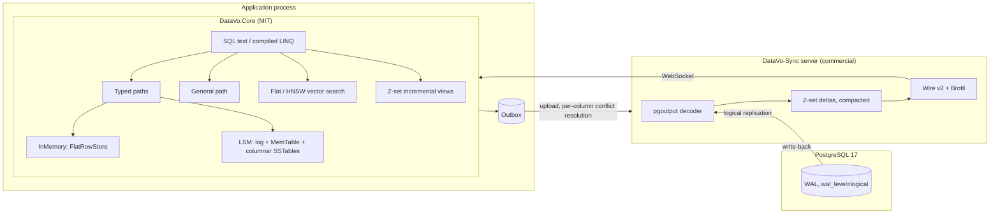

# I wrote an embedded database and Postgres sync engine in C#. Here is where it wins and where it loses.

*Part 1 of 6.*

I have been building two things. **DataVo-DBMS** is an embedded relational and vector database written in managed C# for .NET 10. It is MIT-licensed. **DataVo-Sync** is a separate, proprietary, commercial add-on that keeps a local DataVo database in step with PostgreSQL, including writes made while offline.

This first part is a map. It describes how the pieces work, and it reports the measurements as I have them, including the ones where SQLite, DuckDB or ElectricSQL are better. Later parts take one mechanism each and go deeper.

A few ground rules for reading the numbers:

- Every figure comes from a log or report file in the repositories or the CI artifacts; I list the runs below. Nothing is interpolated.
- Almost everything is a single run on one machine. Only the BenchmarkDotNet figures carry confidence intervals. I treat differences under about 20% as not established.
- Cloud CI runners are shared virtual machines. Compare engines within a run, not across runs or platforms.
- DataVo is prerelease software (`0.4.0-rc.1`). The on-disk format has no compatibility guarantee yet.

| Environment | Hardware | Runtime | Used for |
| --- | --- | --- | --- |
| macOS | Apple M4 Pro, 12 cores, 48 GiB | .NET 10.0.3, macOS 26.3 | SQL and vector matrix (17 Nov), storage workloads (12 Nov) |
| Linux x64 CI | AMD EPYC 9V45, 4 logical / 2 physical cores | .NET 10.0.15, Ubuntu 26.04 | BenchmarkDotNet and research matrix, run `44748508039` (20 Nov) |
| Windows x64 CI | Xeon Platinum 8370C, 4 logical / 2 physical cores, Hyper-V | .NET 10.0.15, Windows 11 24H2 | same run |
| Sync CI | Ubuntu 26.04 x64, **2 vCPU**, PostgreSQL 17.12, ElectricSQL 1.8.1 in Docker | .NET 10.0.15 | DataVo-Sync end-to-end, run `44756364158` (20 Nov) |

## 1. Why build this

The default answer for an embedded relational store is SQLite, and it is usually the right one. It is small, extremely well tested, and has two decades of production use behind it. I want to be clear that none of what follows is an argument against that default.

I had three narrower reasons to try something else.

**A .NET application that owns its data.** SQLite is a native library. Shipping it means a native binary per platform, interop at every call, and a boundary the runtime cannot see through. DataVo is managed code from storage to SQL execution. `DataVo.Core` and `DataVo.Data` build with the trimming and Native AOT analyzers as errors, so an application using them can be published with `PublishAot=true`. That is a packaging property, not a speed claim, and it is only worth something if the engine is also correct and fast enough.

**Relational data and embeddings in one engine.** Many applications now keep vectors next to the records they describe. DataVo has `VECTOR(n)` columns with an exact SIMD `FLAT` index and an `HNSW` index, queried from the same SQL as everything else, with filters and joins, in the same transaction log.

**Local-first sync with PostgreSQL.** Kleppmann et al.'s [local-first software](#references) argues that the primary copy of the data should live on the user's device, with the server as one replica among others. For many .NET applications the server-side replica is PostgreSQL already. That motivates DataVo-Sync: PostgreSQL logical replication in one direction, and an outbox of local writes in the other.

What this is not: DataVo is not a client/server database. One process owns a database directory (`datavo.lock`), transactions are snapshot-isolated rather than serializable, and the SQL is its own dialect. Replication is out of scope for the open-source engine; that is what the sync add-on is for.

## 2. How it works

### The storage engines

**InMemory** keeps rows in a packed row store, `FlatRowStore`: fixed-width cells in contiguous buffers instead of one object per row. The measured table costs 49.2 bytes per row with shared strings, down from 640.3 with the object-per-row layout it replaced. An integer primary key is a hash map from key to row slot. Nothing survives the process.

**LSM** follows the log-structured merge tree of O'Neil et al. A commit is appended to a log, applied to an arena-backed MemTable, and acknowledged. With `LsmStrictFsync = true`, the acknowledgement waits until the log is on stable storage. At 32 MB a MemTable is frozen and written to an immutable SSTable by a background thread, and SSTables are later compacted. If a table's primary key is a single `INT` or `GUID` column, rows are stored under that key, so a key lookup or range is a seek rather than an index probe followed by a row fetch.

**Columnar SSTables.** `CREATE INDEX ... USING COLUMNAR` keeps chosen columns a second time as contiguous buffers. On LSM, flush and compaction write those columns into each SSTable as 4,096-row segments, each with a min/max zone map and NULL/NaN masks. A query like `COUNT(*) WHERE Amount >= @lo` skips any chunk the zone map excludes, and reads surviving chunks straight from memory-mapped files. Opening the database builds nothing. This is the idea behind the column-store results in Abadi et al.: reading only the columns a query needs, in dense typed arrays, is cheap. DataVo's version is opt-in per column, because rows are still its primary layout.

### Typed execution and the general path

SQL is first offered to *typed paths* that read cells directly from stored rows: a single-table scan (`AND`, `OR`, `LIKE`, grouping, bounded top-k, key ranges, index lookups), a hash join for `INNER` and `LEFT` joins on integer keys, columnar aggregates, and a vector planner. A typed path either returns exactly what the general evaluator would, or declines. Anything that no typed path accepts runs on the general path, which builds a dictionary per row and costs kilobytes of allocation per row read.

Most of the performance work so far has been about widening the typed paths so that common queries never fall back. Which side of that line a query lands on explains more of the benchmark results below than any micro-optimization does.

### Vector search

`FLAT` compares the query against every stored vector with SIMD kernels, so it is exact. `HNSW` follows Malkov and Yashunin: a navigable small-world graph searched greedily. A filtered query does not push the filter into the index. It asks for about `LIMIT / selectivity` candidates, tests the filter on the stored rows, and expands the request if too few pass. When the graph walk would cost more than scanning, HNSW switches to an exact scan. If expansion still comes up short, the query scans for passing rows and ranks only those, rather than returning fewer than `LIMIT` rows.

### Z-set incremental views

DataVo can keep a query result up to date as rows change, using the model from Budiu et al.'s DBSP: a table is a *Z-set*, a collection in which each row has an integer weight, so an insert is `+1` and a delete is `-1`. A change to the input becomes a small Z-set delta, and the view is updated from the delta without recomputing the whole query. It only applies to query shapes DataVo can maintain; anything else falls back to normal execution.

### DataVo-Sync

I describe DataVo-Sync at the level of protocol and behaviour only, because it is a commercial product.

PostgreSQL logical replication (`pgoutput`) is decoded into Z-set deltas, compacted, and sent to clients as a columnar wire format (wire v2) compressed with Brotli over WebSocket. The client applies the deltas to a local DataVo store, either `InMemory` or `Lsm`. Local writes go into a crash-recoverable outbox and are uploaded, with conflicts resolved per column (last writer wins), and written back to PostgreSQL.

## 3. Engine benchmarks and correctness

### What "matching durability" means

A database that acknowledges a commit before it reaches stable storage is faster than one that waits, and the comparison is meaningless if the two are mixed. All comparisons below use these pairs:

| DataVo | SQLite | What a commit means |
| --- | --- | --- |
| `LsmStrictFsync = true` ("Production") | WAL, `synchronous=FULL` | Waits for the device on every commit |
| `LsmStrictFsync = false` ("Relaxed") | WAL, `synchronous=NORMAL` | Survives a process crash, can lose recent commits on power loss |

Where I have no matched SQLite row, I say so.

### Point lookups and columnar aggregates

BenchmarkDotNet, 100,000 rows for lookups and 200,000 rows for aggregates, same machine and run for all engines:

| Primary-key lookup | DataVo, memory | DataVo, file (LSM) | SQLite, memory | SQLite, file | DuckDB, 1 thread, file |
| --- | ---: | ---: | ---: | ---: | ---: |
| Linux x64 | 130.8 ns | 288.3 ns | 1,398.2 ns | 3,642.7 ns | 204.1 µs |
| Windows x64 | 239.6 ns | 666.9 ns | 2,024.0 ns | 6,741.1 ns | 380.7 µs |
| Apple M4 Pro (13 Nov) | 52.1 ns | 236.0 ns | 735.6 ns | 1,609.4 ns | 64.9 µs |

| Filtered `COUNT(*)`, `[Columnar]` | DataVo, memory | DataVo, file | SQLite, memory | SQLite, file | DuckDB 1 thread, file |
| --- | ---: | ---: | ---: | ---: | ---: |
| Linux x64 | 9.29 µs | 8.81 µs | 4,553.2 µs | 5,603.4 µs | 538.4 µs |
| Windows x64 | 16.20 µs | 15.94 µs | 8,607.6 µs | 13,446.1 µs | 1,102.2 µs |

DataVo allocates 56 B per in-memory lookup (the returned object itself) and 144 B on the file engine; SQLite allocates 608 B. The aggregate benchmarks allocate nothing in DataVo and 504 B in SQLite.

**Why the numbers look like this.** The lookup benchmark runs *compiled LINQ*. A Roslyn source generator emits the query at build time, so there is no SQL parsing, no planning, and no dictionary per row. On compact in-memory tables the generated code decodes fields straight from the packed row bytes, and point reads take no lock. SQLite's figure includes a B-tree descent and the ADO.NET call. DuckDB's 200–380 µs is, I believe, mostly fixed per-statement setup for a vectorized pipeline, which is not what it is designed to optimize; I did not profile it.

The caveat is that this compares DataVo's compiled path with other engines' SQL path. Through SQL text with prepared statements, the gap is much smaller: on the M4 Pro (12 Nov) a point read by integer key was 1.4 µs for DataVo and 2.0 µs for SQLite. The in-memory Linux lookup also has a wide error bar (StdDev 28.79 ns on a 130.8 ns mean), so treat the Memory column as roughly a tenfold lead, not a precise ratio.

The aggregate result needs more care. The lead exists because those queries use a columnar index, which answers a filtered count from a bitmask over 4,096-value chunks without touching rows. **Without the index, DuckDB held to one thread is faster than DataVo's row scan**: on the M4 Pro DataVo's row-scan `COUNT` took 386 µs against 137 µs for DuckDB. And through SQL text rather than compiled LINQ, the same index gives 3.18 ms for a filtered `COUNT` over 1,000,000 rows against SQLite's 43.66 ms, while DuckDB, using all 12 cores, takes 1.13 ms. A column store is faster than a row store with a columnar side index on whole-table analytics, which is what you would expect.

On x64, DataVo's lead over SQLite on the *row-scan* aggregate (no columnar index) was also smaller than on the M4 Pro in the 12 Nov CI run: 3.5 to 4.7 times, against 9 to 10 on the Mac. I did not profile why, and I would quote the lower range for x64 servers.

### Concurrent operations, and a result I could not report

The `concurrent-ops` scenario runs 8 reader threads and 2 writer threads for 5 seconds against 100,000 records.

On 12 November, on the same two 4-core runners, DataVo's writers completed **zero** writes. The reported 2.1 and 2.4 million ops/s were reads only, and I said so in the results page and declined to present it as a comparison: it looked like starvation of the writers by ten busy threads on four logical cores, and I had not established whether the cause was CPU scheduling or lock fairness in the engine.

On 20 November, at `master` @ `02fa240f`, the same scenario completes writes on both runners:

| Platform | Engine | Reported ops/s | Reads | Writes | Read p99 | Write p99 |
| --- | --- | ---: | ---: | ---: | ---: | ---: |
| Linux x64 | DataVo | 1,530,919 | 20,405,025 | 302,878 | 0.007 ms | 0.125 ms |
| Linux x64 | SQLite | 244,903 | 2,464,746 | 2 | 0.118 ms | 10,061 ms |
| Windows x64 | DataVo | 1,535,444 | 21,194,024 | 98,696 | 0.009 ms | 1.084 ms |
| Windows x64 | SQLite | 432,870 | 2,231,788 | 2 | 0.041 ms | 5,152 ms |

Between the two runs, a series of lock and snapshot changes landed: commit-ordered snapshots, bounded waits on the snapshot gate, correct accounting of write-lock owners, and coordination between row write locks and table write locks. I have not bisected them, so I cannot tell you which one removed the starvation. I would be more comfortable with an answer than with this paragraph.

The SQLite column deserves its own warning. SQLite completed two writes in the run, and the harness reports a total of 10,064 ms (Linux) and 5,156 ms (Windows) for a nominal 5-second window. My earlier results page attributed the multi-second write p99 to a writer waiting out its busy timeout, and I have not investigated further. So SQLite's ops/s here is essentially read throughput with the writers shut out. It is a property of this contention setup, ten threads on four cores, not a typical SQLite write latency, and I would not use it to claim that DataVo handles mixed load several times better.

### Durable commits and YCSB

| 50,000 durable point updates, median latency | Linux x64 | Windows x64 | M4 Pro (20,000 updates, 12 Nov) |
| --- | ---: | ---: | ---: |
| DataVo Production (`StrictFsync`) | 0.2405 ms | 3.9163 ms | 4.04 ms |
| SQLite WAL `FULL` | 0.1076 ms | 3.9218 ms | 4.04 ms |
| DataVo Relaxed | 0.0086 ms | 0.0272 ms | |
| SQLite WAL `NORMAL` | 0.0114 ms | 0.0134 ms | |

Where the device flush costs milliseconds, as on the Mac's SSD and the Windows runner, the two durable engines are indistinguishable. The cost is the flush, and neither engine can skip it. That is the honest result, and it is the subject of Part 3.

On the Linux runner the flush is cheap, and then SQLite is faster: 0.1076 ms against 0.2405 ms per update, and 6.8 s against 13.3 s over 50,000. DataVo also allocates more per update (968.2 B against 512.1 B). I have not profiled the Production commit path. The group-commit machinery is the obvious place to look, and that is an inference from the design rather than a finding.

YCSB (80% reads, 20% updates, 4 threads, 100,000 preloaded records), matched at Relaxed against `NORMAL`:

| | DataVo Relaxed | SQLite `NORMAL` | DataVo Production |
| --- | ---: | ---: | ---: |
| Linux x64 | 230,912 ops/s, write p99 0.43 ms | 98,295 ops/s, 3.20 ms | 35,645 ops/s, 1.13 ms |
| Windows x64 | 70,735 ops/s, write p99 1.05 ms | 33,256 ops/s, 7.49 ms | 1,360 ops/s, 48.67 ms |
| M4 Pro, 12 threads | 510,695 ops/s, 0.66 ms | 261,618 ops/s, 3.77 ms | |

There is no SQLite `FULL` row in the YCSB logs, so the Production column has no matched comparator. It is there to show what the flush costs on Windows.

### Space, recovery, and the matrix

1,000,000 records, inserted in one batch, closed, and reopened inside the same process with a warm page cache. This is a clean reopen, not crash recovery:

| | Insert | On disk | Reopen | First read after |
| --- | ---: | ---: | ---: | ---: |
| DataVo Production, Linux | 1,365.8 ms | 28.155 MB | 27.3 ms | 10.4 ms |
| DataVo Relaxed, Linux | 946.4 ms | 28.155 MB | 1.6 ms | 0.1 ms |
| SQLite `NORMAL`, Linux | 1,839.1 ms | 29.082 MB | 0.6 ms | 3.9 ms |
| DataVo Production, Windows | 1,811.5 ms | 28.155 MB | 40.3 ms | 14.1 ms |
| DataVo Relaxed, Windows | 1,299.3 ms | 28.155 MB | 3.9 ms | 0.1 ms |
| SQLite `NORMAL`, Windows | 2,605.2 ms | 29.082 MB | 1.8 ms | 5.4 ms |

The files are 3% smaller than SQLite's. SQLite reopens faster than DataVo Relaxed on both platforms, and much faster than DataVo Production. I do not have a mechanism for the gap between Production and Relaxed reopen times.

#### The 28-query SQL matrix

This is where I think the comparison is most informative, because every query is a statement prepared once, the data is identical in every engine, and every answer is checked before it is timed.

Setup: 1,000,000 orders, 100,000 customers, 1,000 products; DataVo LSM Relaxed against SQLite WAL `NORMAL`; median of one call; Apple M4 Pro; 17 November. The ratio is SQLite's median divided by DataVo's. Counting the shapes at a 20% threshold, **18 favour DataVo, 6 are within 20%, and 4 favour SQLite**. The columnar shapes (C1–C8) are counted with the columnar index in place. Without it, C1, C2, C4 and C6 are all slower than SQLite (0.82×, 0.55×, 0.66×, 0.55×).

The wins:

| Shape | DataVo | SQLite | SQLite ÷ DataVo |
| --- | ---: | ---: | ---: |
| J1 three-table inner join, aggregate | 70.16 ms | 721.36 ms | 10.28× |
| J6 Orders × Customers `GROUP BY` | 130.33 ms | 764.43 ms | 5.87× |
| G1 `GROUP BY` 4 groups | 50.54 ms | 237.49 ms | 4.70× |
| G2 `GROUP BY` 1,000 groups | 63.38 ms | 209.16 ms | 3.30× |
| W1 equality on a secondary index | 341.4 µs | 824.6 µs | 2.42× |
| R4 key range, 10,000 rows | 990.9 µs | 1.74 ms | 1.76× |
| C1 `COUNT(*)` with columnar index | 3.18 ms | 43.66 ms | 13.73× |

The mechanisms are mostly the same few. On joins, SQLite runs an index nested-loop join, one B-tree descent per joined row, a million times. DataVo hashes the small side once and probes an in-memory structure per row; when a table contributes only its key, the keys become a bit set. On `GROUP BY` with few groups, DataVo aggregates into a hash table while it streams rows. SQLite sorts into a temporary B-tree, which is more work when groups are few. On key ranges, the clustered table makes a range a seek and a sequential read, the same access pattern SQLite uses.

The losses are in section 5. The first run of the matrix also found wrong answers, which come next; Part 6 covers how it was built.

#### Five wrong answers

Before any query is timed, the runner compares each engine's answer to an exact answer computed from its own data generator. The first run, on 14 November against the unmodified engine, found **five queries on which DataVo returned the wrong answer**, on both storage engines:

| # | Query shape | DataVo returned | Correct |
| --- | --- | ---: | ---: |
| B1 | `LEFT JOIN ... WHERE c.Id IS NULL` | 0 | 250,395 |
| B2 | `COUNT(DISTINCT CustomerId)` | 2,000 | 175 |
| B3 | filtered vector search over aliased tables | 0–2 rows (recall@10 5%) | 10 rows |
| B4 | `AND` across two joined tables | 0 rows | 1,827 rows |
| B5 | vector search joined to a filtered table | 10 rows, 9 of them failing the filter on average | 10 rows from that country |

Each had a distinct cause: a `WHERE` comparison on the NULL-supplying side of an outer join applied before the NULL padding existed; a parser that dropped `DISTINCT` inside an aggregate; a planner that compared a table alias with a table name; row keys listed in a different table order depending on which table the join started from; and a vector join path that applied only the part of `WHERE` naming the vector table. All five are fixed with regression tests. I mention them here because the speed numbers above are worth little without this: a fast wrong answer is not fast. Slutz's [massive stochastic testing](#references) and Rigger and Su's pivoted query synthesis are the ancestors of this kind of check, though the oracle here is an exact answer from the data generator rather than another database.

### Vector search

At 50,000 documents of 384 dimensions with clustered embeddings, filtered top-10 queries (DataVo against SQLite with sqlite-vec, whose `vec0` is an exact scan):

| Shape | DataVo Flat | DataVo HNSW | sqlite-vec |
| --- | ---: | ---: | ---: |
| V0 no filter | 2.19 ms | 0.26 ms | 18.2 ms |
| V1 filter, ~5% of rows | 2.64 ms | 2.48 ms | 9.78 ms |
| V2 filter, ~50% of rows | 2.04 ms | 0.67 ms | 14.4 ms |
| V3 V1 plus a join | 2.56 ms | 2.42 ms | 9.76 ms |
| V4 join, ~10% survive | 4.34 ms | 3.62 ms | 13.1 ms |

Recall@10 was 100% on every shape, with no short results and no returned row failing its filter. sqlite-vec applies metadata filters inside its scan and computes no distance for a row that fails, so its margin narrows when a filter is selective; DataVo computes all the distances and filters afterwards. At 1,536 dimensions the narrowest result is V4 with Flat at 1.4× faster than sqlite-vec.

## 4. End-to-end Postgres sync

All of this ran on Ubuntu 26.04 x64 with **2 vCPUs**, PostgreSQL 17.12, over loopback sockets, in CI run `44756364158`. PostgreSQL, the sync server, and the clients all share that VM. Nothing is mocked. The comparison stacks are:

- **DataVo-Sync** into DataVo `inmemory`, `lsm` (no fsync per commit), and `lsm-strict` (fsync per commit).
- **A custom SQLite + JSON/WebSocket baseline** that I wrote: the sort of thing a capable team would build without DataVo, with and without per-message deflate, into SQLite WAL `NORMAL` and `FULL`. It is a one-way downlink. It has no uploads, no conflict handling, no offline queue and no authorization, so it has less to do than DataVo-Sync on every path.
- **ElectricSQL 1.8.1**, using its Shape API into SQLite WAL `NORMAL`, in Docker on the same VM. In this setup it is a read path. I did not tune it, and its server-side CPU is not part of the table.

### Initial sync

Warm is the median of runs 2–4 in one client process. Wire bytes are TCP bytes in both directions, counted the same way for every stack.

| | 10,000 rows, warm | 100,000 rows, warm | Wire B/row (100k) | Client allocations (100k) |
| --- | ---: | ---: | ---: | ---: |
| DataVo-Sync → `inmemory` | 162 ms | 605 ms | 45.5 | 36.4 MB |
| DataVo-Sync → `lsm` | 226 ms | 726 ms | 45.5 | 49.1 MB |
| DataVo-Sync → `lsm-strict` | 80 ms | 706 ms | 45.5 | 49.1 MB |
| JSON → SQLite `NORMAL` | 195 ms | 832 ms | 214.8 | 129.9 MB |
| JSON + deflate → SQLite `NORMAL` | 219 ms | 852 ms | 58.5 | 130.2 MB |
| JSON → SQLite `FULL` | 168 ms | 702 ms | 214.8 | 129.9 MB |
| JSON + deflate → SQLite `FULL` | 218 ms | 909 ms | 58.5 | 130.0 MB |
| ElectricSQL 1.8.1 → SQLite `NORMAL` | 348 ms | 1,167 ms | 362.7 | 251.4 MB |

On time, DataVo-Sync and the JSON baseline are in the same range at 100,000 rows. The strict pair (`lsm-strict` at 706 ms, SQLite `FULL` at 702 ms) is a tie. The JSON rows moved by up to 1.7× between earlier runs, so I would not read an ordering into the first seven bars, and the 10,000-row column is partly measuring JIT tiering: `lsm-strict` at 80 ms being faster than `inmemory` at 162 ms is not a real property of the engines. The clear differences are in the other two columns. DataVo-Sync sends 45.5 bytes per row, against 214.8 for plain JSON, 58.5 for JSON with deflate, and 362.7 for ElectricSQL. Client allocation for the 100,000-row sync is 36.4 to 49.1 MB, against about 130 MB and 251.4 MB. ElectricSQL's 1,167 ms is 1.6 to 1.9 times DataVo-Sync's.

Why the bytes differ: wire v2 is columnar before it is compressed, so I expect Brotli sees runs of similar column values, where the JSON baseline repeats property names in every row. I did not isolate that. The allocations are a story of their own and Part 4's subject. In short: before a change I call zero-allocation initial sync, the client allocated about 1.2 GB for 100,000 rows on the M4 Pro, and afterwards the tens of megabytes shown here.

Before that change, on the M4 Pro, the JSON/SQLite baseline reached a usable replica 1.9 to 3.5 times faster than DataVo-Sync at 100,000 rows. I have not re-run that comparison on the Mac with the current code, so the CI result above is what I can stand behind.

Three things temper these results.

- **Loopback hides the wire.** There is no bandwidth or latency limit. On a metered mobile link, bytes would dominate and the ordering of the time column could change. I did not test that. On loopback, deflate costs the JSON stack time rather than saving it.
- **Cold start is slower.** A new client process takes 1,198 to 1,910 ms for its first 100,000-row sync, against 1,581 to 2,266 ms for the JSON stack and 2,977 ms for ElectricSQL. Native AOT was not measured.
- **The hub pays at startup.** A DataVo-Sync server must copy the table into its in-memory hub before it serves: 708 ms for 10,000 rows and **2,412 ms for 100,000**. The JSON server is ready in 299 ms because it reads PostgreSQL per client instead. DataVo's design makes snapshots cheap for each additional client and expensive to start; the JSON design is the opposite.

### Reads on the synced replica

10,000 point lookups, reading all eight columns, and 1,000 range aggregates (`COUNT(*), SUM(score) ... WHERE id >= @lo AND id < @lo + 100`) on the 100,000-row replica; prepared statements; single thread; identical checksum on every replica.

| Replica | Point lookup | Point alloc | Range aggregate | Range alloc |
| --- | ---: | ---: | ---: | ---: |
| DataVo `inmemory` | 4.06 µs | 28 B | 132.83 µs | 0 B |
| DataVo `lsm` | 5.19 µs | 277 B | 276.82 µs | 0 B |
| SQLite `NORMAL` | 8.86 µs | 735 B | 16.83 µs | 624 B |
| SQLite `FULL` | 8.27 µs | 735 B | 16.95 µs | 624 B |

DataVo is faster on point reads. SQLite is faster on the 100-row range aggregate, by a wide margin, and I return to that below.

### Live propagation

The clock starts before a PostgreSQL commit is sent and stops when the replica's primary-key lookup returns the new value. 1,000 sequential commits, alternating insert and update (ElectricSQL: 100 commits, live long-poll).

| Stack | p50 | p95 | p99 | max |
| --- | ---: | ---: | ---: | ---: |
| DataVo-Sync → `inmemory` | 2.25 ms | 8.17 ms | 10.07 ms | 17.28 ms |
| DataVo-Sync → `lsm` | 1.98 ms | 5.83 ms | 9.33 ms | 20.36 ms |
| JSON → SQLite `NORMAL` | 1.33 ms | 3.04 ms | 4.82 ms | 23.33 ms |
| JSON → SQLite `FULL` | 1.53 ms | 4.66 ms | 7.00 ms | 10.64 ms |
| ElectricSQL long-poll | 3.44 ms | 7.90 ms | 9.14 ms | 11.07 ms |

The JSON baseline is faster at p50 and p99 than DataVo-Sync here. Part of the reason is structural: the JSON server pushes each transaction directly, while DataVo-Sync goes hub, change notification, then pull. A separate DataVo run of the same procedure measured `lsm` at 1.09 ms p50, so the spread between runs is as large as some of the differences between stacks. The PostgreSQL commit round trip itself is part of every sample (0.48 to 0.79 ms at p50 for DataVo-Sync).

### Fan-out and offline convergence

Twenty thousand rows (200 PostgreSQL transactions of 100 rows) written back to back, with every replica an in-memory DataVo database in one client process:

| Clients | All converged | Aggregate rows/s | Per-client rows/s (median) |
| ---: | ---: | ---: | ---: |
| 1 | 1.29 s | 15,452 | 15,452 |
| 10 | 3.15 s | 63,518 | 6,398 |
| 50 | 7.13 s | 140,218 | 2,842 |

All 50 clients run in one process on the same 2-vCPU machine as PostgreSQL and the server. This measures client CPU and GC contention at least as much as hub capacity, although the hub averaged 1.02 cores. In a deployment each client would be a device.

The offline test is the one the JSON baseline cannot take part in. PostgreSQL holds 1,000 rows. Replicas A and B are synced. A loses its transport, commits 500 local changes (400 inserts and 100 updates) one statement at a time, then reconnects. In all 6 of 6 CI runs, PostgreSQL, A and B were identical row by row across all columns (1,400 rows compared). B saw A's changes 80.9 to 243.4 ms after reconnect, and PostgreSQL committed them 188.6 to 259.0 ms after. B is quicker because the hub accepts an upload before the write-back to PostgreSQL finishes; write-back to PostgreSQL is serial.

### Many connections

This is the weakest comparison in the article, so I will state its limits plainly. It exercises DataVo-Sync's hub and WebSocket transport only. **PostgreSQL is not in the loop**, and I have no equivalent series for the JSON baseline or ElectricSQL. Each client does 10 cycles of 20 rows. Clients and server share a 2-vCPU VM.

| Clients | Rows | Rows/s | p50 | p95 | p99 | Wall |
| ---: | ---: | ---: | ---: | ---: | ---: | ---: |
| 10 | 2,000 | 14,273 | 10.63 ms | 26.70 ms | 30.42 ms | 0.14 s |
| 100 | 20,000 | 9,784 | 158.87 ms | 300.40 ms | 393.95 ms | 2.04 s |
| 1,000 | 200,000 | 12,754 | 1,220.10 ms | 3,418.56 ms | 4,636.53 ms | 15.68 s |

All 1,000 clients connected and completed, and total throughput stayed between 9.8k and 14.3k rows/s. Latency did not stay flat: p50 grew from 10.63 ms to 1,220.10 ms and p99 to 4.6 s. That is what a saturated 2-vCPU machine looks like when 1,000 clients share it; the run allocated 4,504 MB. Completing 1,000 clients with a 1.2 s median is not the same as serving 1,000 interactive users well, and I make no such claim.

## 5. Where it still loses, and what is open

**Full scans without an index.** When both engines must touch every row and neither has a structure that avoids work, SQLite's row decoder is a little faster. From the matrix:

| Query | DataVo | SQLite | |
| --- | ---: | ---: | --- |
| W6 substring `LIKE '%042-%'` | 68.71 ms | 50.71 ms | SQLite 1.35× |
| C8 unindexed `ORDER BY ... LIMIT 10` | 52.98 ms | 41.57 ms | SQLite 1.3× |
| G3 `GROUP BY` ~125,000 groups of an indexed key | 44.17 ms | 30.54 ms | SQLite 1.4× |
| W4 `OR` plus a NULL-aware filter | 74.19 ms | 63.28 ms | within about 20% |
| W2 equality, no index | 30.46 ms | 28.65 ms | within about 20% |

A CPU profile of W2 taken before the last round of changes put 37% of the time in merging the table's SSTable runs, 17% in stepping the run cursors, and 20% in locating the filtered column in each row. DataVo walks the cells before the one it needs, where SQLite's record header gives each column's offset. G3 is a different story: SQLite reads the groups in order from a covering index and finishes each group when the key changes. DataVo now also answers the counts from the index, but a nullable key means it must still read every row's null flag, which costs about as much as W2's scan. A `NOT NULL` column avoids that walk. DuckDB, a parallel column store, is faster than both on every query that reads the whole table.

C3 (`SUM` of a `DOUBLE`) is a deliberate loss on LSM: floating-point addition is not associative, so the columnar index only answers when it can reproduce the row scan's exact bits, and on LSM it cannot guarantee that, so it declines and SQLite is 1.65 times faster.

**Windows and the flush.** On the Windows runner, a durable update took 3.9163 ms for DataVo Production and 3.9218 ms for SQLite `FULL`: that is the time the OS takes to flush. Two things are worse than a tie. Production YCSB had a write p99 of 48.67 ms with 1,360 ops/s, and Production throughput barely moved with threads: 2,614 ops/s at one thread and 3,300 at 32, where Linux went from 41,381 to 101,380. Either commits are not being grouped on Windows or the flush call serializes them. I have not determined which. An earlier run (12 Nov) measured the same update at 2.42 ms against 2.51 ms, so the flush time itself also varies between runs on these VMs.

**The fixed cost per durable commit.** On Linux, where the flush is nearly free, SQLite's durable update is about twice as fast as DataVo's. A claim of "equal durable write performance" only holds where the flush dominates.

**DataVo-Sync's snapshot startup.** The hub's 2,412 ms to load 100,000 rows before it serves, and the fact that it holds all synced rows in memory, is a real cost for short-lived servers and large tables.

**Local range aggregates.** 132.83 µs (`inmemory`) and 276.82 µs (`lsm`) against SQLite's 16.83 µs and 16.95 µs for a 100-row primary-key range aggregate. I have not dug into why. My notes from the sync benchmarks suggest this shape may not get an ordered primary-key range scan on the replica path, but that is a hypothesis, not a finding.

**HNSW build cost.** On the Linux runner, 10,000 vectors of 1,536 dimensions with 100 queries took 6,197.7 ms total with HNSW, against 571.3 ms with Flat and 2,347.3 ms for SQLite with sqlite-vec, because the graph build costs 6.0 s against 0.2 s. Per query the median is 2.38 ms for HNSW, 3.52 ms for Flat and 19.40 ms for SQLite, so the index pays off per query and not in total unless many queries follow the build. On clustered data on the M4 Pro (12 Nov), the extra build time at 10,000 vectors paid for itself after about 290 queries. Separately, on uniform random 1,536-dimension vectors, which is the worst case for a graph index, HNSW recall was 63.5% at 10,000 vectors (measured before the diversity heuristic became the default, and not repeated on x64). If you build an index and run few queries, use Flat.

**Smaller things.** Closing a database after a bulk load takes 506.1 ms for DataVo against 2.2 ms for SQLite, because the load leaves its last rows in MemTables that close writes out as SSTables. Bulk loading 100,000 rows to a file is within noise of SQLite's on the BenchmarkDotNet runs (mean 146.68 ms, error 77.87 ms, against 144.29 ms, error 11.21 ms, on Linux), and DuckDB's appender is faster than both.

**Where the other tools are the better choice.**

- If you want the default embedded SQL database with the broadest SQL, the largest ecosystem, and two decades of failure experience, use SQLite. DataVo's dialect is its own and its on-disk format may change.
- If your workload is whole-table analytics, use DuckDB. It is one to three orders of magnitude faster than either of us on those queries.
- If you want read-path sync from PostgreSQL into a browser or app from a maintained product, use ElectricSQL. My comparison covers one workload, initial sync and live latency over loopback, not its feature set. In this setup it was a read path; DataVo-Sync adds an offline write path, which is a different scope, not a better implementation of the same one.

## 6. What comes next

- **Part 2.** Packed byte buffers and Roslyn codegen: how a 52 ns point lookup is built, and what it cost in complexity.
- **Part 3.** What an fsync costs, across operating systems: the 4 ms tie, the 0.1 ms Linux case, and the Windows scaling problem.
- **Part 4.** Z-sets, from incremental views to a 36 MB sync: how one data model serves both.
- **Part 5.** HNSW, the JIT, and the exact fallback: recall on clustered data, and why a graph search sometimes loses to a scan.
- **Part 6.** Differential oracle testing: how the matrix found five wrong answers before I had tuned anything.

## References

1. Martin Kleppmann, Adam Wiggins, Peter van Hardenberg, Mark McGranaghan. "Local-First Software: You Own Your Data, in spite of the Cloud." *Onward! 2019* (ACM SIGPLAN).
2. Martin Kleppmann. *Designing Data-Intensive Applications.* O'Reilly Media, 2017.
3. Patrick O'Neil, Edward Cheng, Dieter Gawlick, Elizabeth O'Neil. "The Log-Structured Merge-Tree (LSM-Tree)." *Acta Informatica* 33(4), pp. 351–385, 1996.
4. Mihai Budiu, Frank McSherry, Leonid Ryzhyk, Val Tannen. "DBSP: Automatic Incremental View Maintenance for Rich Query Languages." *Proceedings of the VLDB Endowment* 16(7), pp. 1601–1614, 2023.
5. Yu. A. Malkov, D. A. Yashunin. "Efficient and Robust Approximate Nearest Neighbor Search Using Hierarchical Navigable Small World Graphs." *IEEE Transactions on Pattern Analysis and Machine Intelligence*, vol. 42, no. 4, pp. 824–836, 2020 (online 2018).
6. Daniel J. Abadi, Samuel R. Madden, Nabil Hachem. "Column-Stores vs. Row-Stores: How Different Are They Really?" *SIGMOD 2008*.
7. Manuel Rigger, Zhendong Su. "Testing Database Engines via Pivoted Query Synthesis." *OSDI 2020*. And: Donald R. Slutz. "Massive Stochastic Testing of SQL." *VLDB 1998*.

### Data sources

- DataVo-DBMS: `README.md`, `docs/manual/performance/benchmarks.md`, `docs/manual/performance/datavo-vs-sqlite.md`, and raw results under `docs/public/benchmarks/` (`2026-11-12`, `2026-11-16-v04-final`, `2026-11-17-engine-perf-followups`).
- DataVo-DBMS CI, 20 Nov 2026, `master` @ `02fa240f`, run `44748508039`: Linux and Windows research-matrix logs and BenchmarkDotNet reports.
- DataVo-Sync CI, 20 Nov 2026, run `44756364158`: `compare.md`, `e2e.md`, `stress-10-100-1000.md`, and the repository's `E2E-RESULTS.md`.
- Charts are reproducible from [`make_charts.py`](https://github.com/ArintonAkos/DataVo-DBMS/blob/master/docs/public/blog/part-1/make_charts.py), in which every plotted value is copied from the files above.
