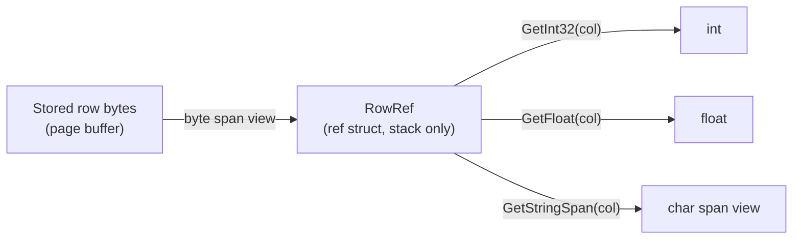

# Zero-Allocation Row Model

DataVo can read rows without creating managed objects for them. The mechanism is `RowRef`, a `readonly ref struct` that points at a row's stored bytes, and `RowRefStream`, which feeds `RowRef` values to a `foreach` loop one page at a time. Once a thread has streamed a table of a given shape, a full pass allocates zero bytes on the managed heap.

This page explains what that means, how to use it, and where it stops applying.

## The idea

A conventional database API materializes each row: a dictionary, an object array or a POCO per row. With 200,000 rows that is 200,000 allocations, and the garbage collector pays for them later.

`RowRef` skips that step. It wraps a `ReadOnlySpan<byte>` over the stored row and decodes a cell only when you ask for it.



Because `RowRef` is a `ref struct`, the compiler guarantees it lives on the stack. It cannot be boxed, stored in a field of a class, captured by a lambda or used across an `await`. That restriction is what makes it safe to point at memory that the engine reuses for the next page.

## Use it

```csharp
using DataVo.Core;

RowRefStream players = db.Table<Player>().StreamRef();

// Look column positions up once, before the loop: this call allocates.
int health = players.GetOrdinal("Health");

float total = 0;
foreach (RowRef row in players)
{
    if (!row.IsNull(health))
    {
        total += row.GetFloat(health);
    }
}
```

The same stream is available without a model type: `db.StreamRef("Players")`.

## Rules for `RowRef`

- **A row is valid only inside the iteration that produced it.** The stream reuses its memory for the next page. Copy any value you need to keep.
- **Spans follow the same rule.** `GetStringSpan` and `GetStringUtf8` return views into the row; copy the text out (for example `new string(span)`) if you need it after the loop body.
- **Accessors require the column's own type**, with lossless widening (`INT` through `GetInt64`, `FLOAT` through `GetDouble`). Any other type throws `InvalidCastException`.
- **A NULL cell throws `InvalidOperationException`.** Check `IsNull` first on nullable columns.
- **Column indexes follow table order**, which is the order of `CREATE TABLE` or of the properties of a `[DataVoTable]` model.

## How a pass behaves

- Rows are read 1,024 at a time. The read lock is held only while a page is copied out of storage, so a slow loop body never blocks writers.
- A pass sees every row that existed for the whole pass exactly once. A row written or deleted during the pass may or may not be seen.
- A schema change to the table during a pass stops it with `InvalidOperationException`.
- Inside an explicit transaction the stream reads through the query engine so it sees the transaction's own writes. **That path allocates.**

## What "zero allocation" covers

The claim is deliberately narrow, and the benchmarks are consistent with it:

| Operation | Allocation |
| --- | --- |
| Full `RowRefStream` pass, after warm-up on that thread | 0 B |
| Compiled `Count`, `Sum`, `Min`, `Max` over a filtered scan of 200,000 rows (see [Compiled Scan Kernels](/manual/internals/compiled-scan-kernels)) | 0 B per query, measured with BenchmarkDotNet's `MemoryDiagnoser` |
| Point lookup into a `Player` on LSM storage | 144 B (the row itself) |
| Point lookup into a `Player` on in-memory storage | 1,008 B, more than SQLite's 608 B |
| A `RowRefStream` pass inside a transaction | Allocates |

The numbers come from the [Benchmark Results](/manual/performance/benchmarks). Zero allocation applies to scans over `RowRef`, not to every API: building a `Player` per row allocates a `Player` per row.

## Native AOT

Nothing here uses reflection or code generation at run time. `DataVo.Core` builds with `IsAotCompatible` enabled and the IL trim and AOT diagnostics treated as errors, so a regression fails the build. See [Native AOT Deployment](/manual/client-interfaces/native-aot).

## Related

- [Compiled Scan Kernels](/manual/internals/compiled-scan-kernels)
- [Query Planner & Fast Paths](/manual/storage-engine/query-planner-fast-paths)
- [Compiled LINQ (Source Generators)](/manual/client-interfaces/source-generators)
