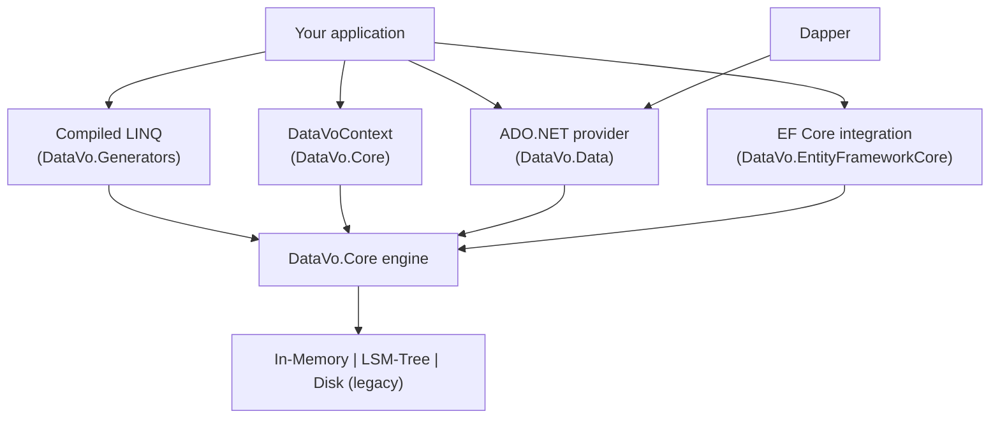

# Choosing an Interface

> Source route: /manual/getting-started/choosing-an-interface
> Source file: manual/getting-started/choosing-an-interface.md

DataVo has five ways to talk to the same engine. They differ in ergonomics and in how much work happens per call, not in what the database can store. You can mix them in one application.

## Decision table

| Interface | Package | Best for | Per-call cost | Native AOT |
| --- | --- | --- | --- | --- |
| [Compiled LINQ](/manual/client-interfaces/source-generators) | `DataVo.Core` + `DataVo.Generators` | Hot paths: point lookups, filtered counts and aggregates. | Lowest. Predicates are compiled at build time; aggregates allocate nothing once warm. | Yes |
| [Embedded API](/manual/client-interfaces/datavo-context-api) (`DataVoContext`) | `DataVo.Core` | Application code that wants SQL, DDL, vector search and full control. | Parses SQL per call unless prepared. Rows come back as dictionaries. | Yes |
| [ADO.NET provider](/manual/client-interfaces/ado-net) | `DataVo.Data` | Code or libraries that already speak `DbConnection`. | Same engine as the embedded API, behind the standard ADO.NET types. | Yes |
| [Dapper](/manual/client-interfaces/dapper) | `DataVo.Data` + `Dapper` | Micro-ORM mapping with plain SQL. | ADO.NET cost plus Dapper's mapping. | Per Dapper's own support |
| [Entity Framework Core](/manual/client-interfaces/entity-framework) | `DataVo.EntityFrameworkCore` | Existing EF models and `DbContext` workflows. | Highest. EF infrastructure sits on top of the engine. | Not claimed |

A short rule of thumb:

- Start with the **embedded API** to learn the engine and for anything that is not performance critical.
- Move the few queries that run constantly to **compiled LINQ**.
- Use **ADO.NET or Dapper** when you are adapting existing code or want a familiar abstraction.
- Use **EF Core** when the rest of your application is already modelled in EF.

## How they fit together



Every route ends in the same parser, planner and storage engines, so storage modes, durability settings and vector indexes behave identically whichever interface you use.

## The same question, five ways

"How many players are level 10 or higher?" The table is `players (Id INT PRIMARY KEY, Level INT)`.

**Embedded API**

```csharp
var result = db.Execute("SELECT COUNT(*) AS Total FROM players WHERE Level >= 10")[0];
object total = result.Data[0]["Total"];
```

**ADO.NET**

```csharp
using var cmd = connection.CreateCommand();
cmd.CommandText = "SELECT COUNT(*) FROM players WHERE Level >= @min";
cmd.Parameters.AddWithValue("@min", 10);
object? total = cmd.ExecuteScalar();
```

**Dapper**

```csharp
int total = connection.ExecuteScalar<int>(
    "SELECT COUNT(*) FROM players WHERE Level >= @min", new { min = 10 });
```

**Entity Framework Core**

```csharp
List<Player> matches = context.QueryFromDataVo<Player>(query =>
    query.Where(static p => p.Level >= 10));
int total = matches.Count;
```

**Compiled LINQ**

```csharp
int total = db.Table<Player>().Where(10, static (p, min) => p.Level >= min).Count();
```

The compiled form reads the `Level` cell straight from the stored bytes and builds no `Player` objects. That is the mechanism behind the zero-allocation aggregates described in [Compiled Scan Kernels](/manual/internals/compiled-scan-kernels).

## Related

- [Installation & Packages](/manual/getting-started/installation)
- [ADO.NET & Dapper tutorial](/manual/tutorial/ado-net-and-dapper)
- [Benchmark Results](/manual/performance/benchmarks), to see what each approach costs in practice.
