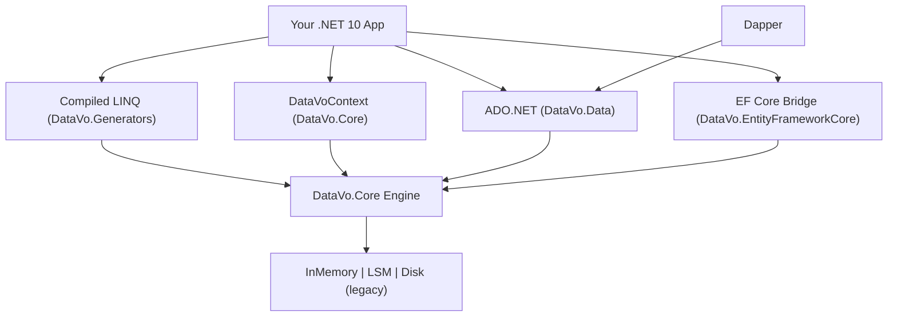

# Choosing an Interface

> Source route: /manual/getting-started/choosing-an-interface
> Source file: manual/getting-started/choosing-an-interface.md

DataVo exposes five ways to query the same embedded engine. They differ in ergonomics and per-call allocation overhead — not in storage modes, durability, or index support — and you can freely mix them in the same process.

## Decision Matrix

| Interface | Packages | Best For | Per-Call Overhead | Native AOT |
| --- | --- | --- | --- | --- |
| [Compiled LINQ](/manual/client-interfaces/compiled-linq) | `DataVo.Core` + `DataVo.Generators` | Hot paths: point lookups, filtered scans, aggregates, projections | Lowest — reads stored bytes directly; zero-alloc aggregates | Yes |
| [`DataVoContext`](/manual/client-interfaces/datavo-context-api) | `DataVo.Core` | Ad-hoc SQL, DDL, prepared statements, vector search, reactive views | Low with `db.Prepare(...)`; materializes dictionaries on general path | Yes |
| [ADO.NET](/manual/client-interfaces/ado-net) | `DataVo.Data` | Libraries expecting `DbConnection`, `DbCommand`, `DbDataReader` | Same engine behind standard `System.Data.Common` wrappers | Yes |
| [Dapper](/manual/client-interfaces/dapper) | `DataVo.Data` + `Dapper` | Plain SQL mapped to POCOs with familiar micro-ORM APIs | ADO.NET overhead plus Dapper row mapping | Per Dapper |
| [EF Core Bridge](/manual/client-interfaces/entity-framework) | `DataVo.EntityFrameworkCore` | Existing EF Core `DbContext` models (experimental preview) | Highest — EF Core infrastructure sits above DataVo | No |

**Rule of thumb:** start with `DataVoContext` for DDL and general SQL, move hot-path reads and aggregates to **Compiled LINQ**, use **ADO.NET / Dapper** when integrating existing SQL codebases, and use the **EF Core bridge** only when you already depend on EF Core.

## How Every Interface Connects



## The Same Query, Five Ways

Counting players with `Score >= 1000` in the `players` table:

**1. `DataVoContext` (SQL)**

```csharp
var result = db.Execute("SELECT COUNT(*) AS Total FROM players WHERE Score >= 1000")[0];
object? total = result.Data[0]["Total"];
```

**2. Compiled LINQ (`DataVo.Generators`)**

```csharp
int total = db.Table<Player>().Where(1000, static (p, min) => p.Score >= min).Count();
```

**3. ADO.NET (`DataVo.Data`)**

```csharp
using var cmd = connection.CreateCommand();
cmd.CommandText = "SELECT COUNT(*) FROM players WHERE Score >= @min";
cmd.Parameters.AddWithValue("@min", 1000);
object? total = cmd.ExecuteScalar();
```

**4. Dapper**

```csharp
int total = connection.ExecuteScalar<int>(
    "SELECT COUNT(*) FROM players WHERE Score >= @min",
    new { min = 1000 });
```

**5. Entity Framework Core Bridge**

```csharp
List<Player> matches = efContext.QueryFromDataVo<Player>(q =>
    q.Where(static p => p.Score >= 1000));
int total = matches.Count;
```

::: info DataVo Extension
Compiled LINQ reads the `Score` cell directly from packed row buffers without allocating `Player` instances. See [Compiled Scan Kernels](/manual/internals/compiled-scan-kernels) for how the generated code works.
:::

## See Also

- [DataVoContext API](/manual/client-interfaces/datavo-context-api) — Primary SQL, prepared statement, and batch write API.
- [Roslyn Source Generators](/manual/client-interfaces/source-generators) — `[DataVoTable]`, `[DataVoQuery]`, and build-time codegen.
- [Compiled LINQ](/manual/client-interfaces/compiled-linq) — Supported LINQ operators and interceptor setup.
- [Benchmarks](/manual/performance/benchmarks) — Measured latency and allocation cost across interfaces.
