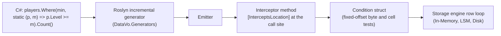

# Compiled Scan Kernels

> Source route: /manual/internals/compiled-scan-kernels
> Source file: manual/internals/compiled-scan-kernels.md

A typed table query such as `db.Table<Player>().Where(...).Count()` does not build an expression tree and does not interpret a predicate per row. The DataVo source generator reads the lambda while your project builds and replaces the call with generated code. For conditions over fixed-width columns, that generated code is a scan kernel that tests stored bytes in place.

This page describes how that works, what shapes are compiled, and what happens when a shape is not.

## Pipeline



1. **Analyze.** The incremental generator finds `DataVoTable<T>` calls and parses each lambda. Only the pieces that can be expressed without running code are accepted: comparisons, boolean tests, null tests, `&&`, `||` and parentheses.
2. **Emit.** For each call site it writes an interceptor in the `DataVo.Generated` namespace, marked with `[InterceptsLocation]`, so the compiler routes that exact call to generated code. The emitted code uses members within C# 9.
3. **Compile the condition.** When the condition reads only unindexed `int`, `long`, `float`, `double`, `bool` or `Guid` columns, the generator also writes it as a struct. The storage scan calls that struct for each row, where the row is stored.
4. **Run.** The scan is generic over the condition struct all the way into the storage engine's row loop, so no delegate is called per row.

Nothing is reflected over or compiled at run time, which is why these calls are safe under Native AOT.

## What the kernel does

When every column up to the last one the query reads has a fixed width (`int`, `long`, `float`, `double`, `bool`, `Guid`, dates), values sit at the same byte offset in every row whose leading cells are all present. The condition is then compiled in a form that reads stored bytes at those offsets. Offsets are worked out once per scan, no row view is built, and there is no branch between the condition's tests.

Each row is first checked against that layout by its leading null flags. A row that differs, such as one holding a NULL in a leading column, is tested the general way, so results are identical. In-memory tables are read the same way from their typed cells.

Put fixed-width columns before text columns in a model to get this path. A condition on a column that follows a `string` still runs in the scan, through the general reader.

## Aggregates

| Call | Compiled scan | Notes |
| --- | --- | --- |
| `Count()`, `Any()` | Yes, for conditions on unindexed fixed-width columns | No model objects are built. |
| `Sum(selector)` | Yes, when the selector is one non-nullable column of its own type | `int`, `long`, `float`, `double`. The total stays in the scan's own variables. Integer overflow throws `OverflowException`. |
| `Min(selector)`, `Max(selector)` | Yes, when the selector is one `int`, `long`, `float`, `double`, `DataVoDate` or `DateOnly` column | Null values are skipped. `NaN` orders below every number. |

Any other selector (`p => p.Gold * 2`, a cast, a text column) runs as written over the rows and allocates accordingly.

```csharp
long gold = db.Table<Player>().Where(static p => p.IsActive).Sum(static p => p.Gold);
long poorest = db.Table<Player>().Where(static p => p.IsActive).Min(static p => p.Gold);
```

Inside a transaction the rows are streamed instead of read in place, so the result includes the transaction's own writes and the call allocates.

## What is measured

On the [Benchmark Results](/manual/performance/benchmarks) (200,000 rows, half of them matching, one local run), the compiled aggregates allocate 0 B per query, against 504 B per query for SQLite and 1,137 to 1,169 B for DuckDB through ADO.NET. On file-backed storage DataVo's aggregates run 2.3 to 2.6 times faster than SQLite's. DuckDB, a multi-threaded column store, is faster than DataVo on these aggregates. Read the [Benchmark Results](/manual/performance/benchmarks) for the full context, including which numbers vary.

One open item is documented honestly there: in memory, rows inserted through the typed batch API are kept as typed cells, and the time to scan them depends on which cells a query touches. The same queries over rows inserted through SQL, which are kept as stored bytes, are faster.

## Not compiled

A call the generator cannot compile still returns the right rows. It reads the whole table and filters it with the lambda, and the build reports why (`DATAVOL001` to `DATAVOL003`). Reasons include capturing a local variable, calling a method, doing arithmetic in the predicate or comparing two columns. A condition on the primary key or an indexed column keeps using the index instead.

The full table of supported lambda shapes and diagnostics is in [Compiled LINQ (Source Generators)](/manual/client-interfaces/source-generators#what-is-compiled).

## Related

- [Zero-Allocation Row Model](/manual/internals/zero-allocation-rows)
- [Query Planner & Fast Paths](/manual/storage-engine/query-planner-fast-paths)
- [Storage Modes](/manual/storage-engine/storage-modes)
